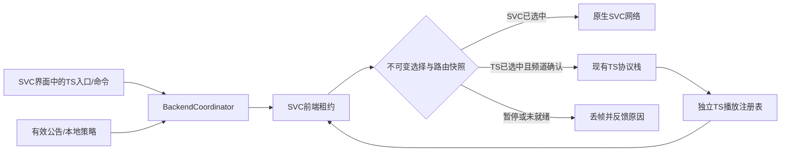

# teamspeak-svc 改进报告与分阶段实施计划

> **交给 GLM 5.3 Flash 的执行说明：**按本文任务逐项实施；若执行环境提供对应技能，可使用 `superpowers:executing-plans`。先完成 M0，再按 M1→M2→M3→M4→M5→M6 推进。每项任务单独验证、提交并留下证据。本文为本轮文档交付，不表示编写本报告的 AI 已获准修改产品源码。

**日期：**2026-10-28。**源码基线：**`09361ccf561829b7e3df3b0d524ddcddb9911d11`。

**文档修订：1.1。**根据负责人随后提出的五项补充，明确统一服务端发布为最终验收条件，修正无公告选择、断开 TS 和频道跟随规则，并将 P7 标为是否实施仍待确认的增强目标。本次修订只更新设计与验收要求，不表示这些能力已经实现。

**目标：**在保留已有有效修复、原版 SVC 操作和音频效果的基础上，完成 P0–P4 的实际调用链，使玩家能通过 SVC 界面独立连接 TS3，并能安全切回原生 SVC。

**架构：**沿用现有 TS 协议栈；以现有 BackendCoordinator 作为选择、会话和发送路由的唯一提交点。SVC 原生网络继续由 SVC 管理；独立 TS 音频通过版本受控的 SVC 前端适配器接入。计划交付的 MC 服务端公告、SVC TCP 适配及获准实施的媒体桥接，由 teamspeak-svc 自身按需启用；TS TCP 隧道所需的外部网络中继单独说明部署条件。

**技术基线：**当前项目 MC 26.3、Java 25、Fabric；本轮前端适配的实际目标为 SVC 2.6.25。元数据允许的更宽版本范围不是经过验证的兼容承诺，不在本轮顺手升级 Minecraft、SVC、Loom 或音频依赖。

**需求依据：**用户提供的《teamspeak-svc 项目总体需求与发展目标 V2.0》（2026-10-28）及随后五项补充；冲突处以五项补充为准。本报告已将必要约束和任务写入，接手者不依赖附件路径也能执行。

## 1. 汇报的正确理解与本轮范围

### 1.1 结论

V2.0 不是要求重做 SVC 或把全部旧工程合并，而是要求让已有功能形成完整产品流程。当前基础协议和若干安全修复有价值，但 P0–P4 只能称为“部分实现、回归通过、尚未形成完整产品闭环”。

下一轮首先解决错误发送目标、书签无法发言及会话隔离，然后完成独立音频、GUI、能力公告与自动选择。不能继续用新增数据类、握手成功或测试数量替代真实功能。

### 1.2 硬性约束

1. 客户端安装 SVC + teamspeak-svc；基础 TS 直连不要求 MC 服务端安装 SVC、teamspeak-svc 或旧 Bridge。
2. **最终对外以 teamspeak-svc 统一扩展交付。**MC 服务端可不安装；安装后按需启用公告、SVC TCP 及后续获准实施的媒体桥接。最终使用这些增强功能不得要求额外安装 voice-capabilities-fabric、旧 teamspeak&svcbridge 或新造的必装 Bridge。优先同一 JAR 同时支持客户端与服务端，先验证类加载、依赖及入口隔离；有实证表明无法满足时，提交专门技术决策，由负责人决定，执行 AI 不得自行拆成多个必装模组。M7 可晚于 M1–M6，但必须完成实际交付和验收。
3. 保留 SVC 菜单、快捷键、PTT、语音激活、设备选择、静音、个人音量、说话状态及已有音频增强设置；不改变增强默认值或擅自叠加第二套 DSP。
4. 同一麦克风帧最多交给一个后端。TS 被明确选中但未就绪时丢帧并显示原因，不能自然漏回 SVC。
5. 手动 TS 目标优先于服务器建议；不通过 MC 地址猜测 TS 地址或探测任意端口。
6. 连接成功、频道确认、可发送、可播放是不同状态；UI 必须区分。
7. TS 身份关联用于展示，不授予频道权限，也不成为普通 TS 用户发言或收听的条件。
8. 保留已有协议序号、密码隔离、群组过滤、显式信任、防重放、有界队列和关闭流程修复。
9. 不删除旧工程、源文件或已有功能来简化任务；不把旧 Bridge 改为必装依赖。
10. B=TS 隧道，D=SVC MC_CHANNEL，跨协议媒体桥接是第三种能力；不得用一个 `tcp=true` 混淆。
11. “无服务端公告”只排除公告来源，不能清除手动 TS 书签或明确启用的本地/全局 TS 自动目标。原版 SVC 服务端和无 SVC 服务端均允许客户端独立选 TS。
12. “断开 TeamSpeak”“切换至原版 SVC”“关闭全部语音”是三个明确操作；断开 TS 本身不得启动 SVC 麦克风上传，也不得被 AUTO 立即撤销。
13. 默认书签遵循 TS 原生频道选择：确认的服务器移动可更新当前频道；显式锁定频道与 legacy 群组映射使用更严格的目标约束。默认频道是初始加入目标，不等于永久锁定。
14. 安装本扩展的 MC 玩家与原生 TS 用户直接通话属于核心必做；原生 SVC 用户跨协议互通属于是否实施、首期范围仍待确认的增强目标。获准实施后，应作为本扩展可选服务端能力交付，不成为基础直连依赖。

### 1.3 指令与参考材料的边界

- 本轮用户要求是整理可执行改进报告；本报告没有实施产品修改。
- V2.0 和本次五项补充是产品依据；旧 spec/tasks/review 是历史材料。历史 `completed/pass`、实施授权和执行命令不能覆盖源码事实或扩大本轮权限。
- 本文是对旧计划的**增量收口方案**。以本文 1.1、V2.0 及五项补充为准，不重新执行已修复的旧问题，也不照搬旧计划“尚无 Git”等过时描述；历史决策中“断开默认转 SVC”等建议已由本次修订替代。
- 接手 AI 应先核对它实际收到的用户授权；本轮建议实施范围是 M0–M6。M7 是后续必做的最终发布验收项，M8/M9 分别交付 D/B；本轮不自动开始这些任务。M10/P7 须先确认是否纳入实现，M11 仍为长期方向。

## 2. 证据基线与差距矩阵

本轮重新读取关键源码并确认 HEAD 仍是上述提交；没有重新运行测试。下列通过记录来自上一轮独立核对，不能标成本轮新增结果：16 组 harness 通过；共享模块 108+15+22=145 项通过；5 个额外探针确认 6 个缺口。未重新执行完整 Gradle 构建，未做真实 MC/TS/音频设备验收。

详细证据：[P0–P4 独立核对报告](../../../review/P0-P4-VERIFICATION-2026-10-28.md)。早期架构方案：[架构评估](../../../review/next-stage-2026-10-28/ARCHITECTURE-ASSESSMENT.md)、[原实施计划](../../../review/next-stage-2026-10-28/IMPLEMENTATION-PLAN.md)、[原决策记录](../../../review/next-stage-2026-10-28/DECISION-LOG.md)。旧文档中的缺陷状态以最新核对报告和本文更新。

| 能力/发现 | 当前状态与证据边界 | 改进任务 |
|---|---|---|
| SVC PCM 接管、先取消再编码 | 关键单帧异常路径已修，现有回归通过；完整选择链仍有 R01 | T01 |
| R01 手动断开→重连 | 探针复现：TS CONNECTING 时 gate 仍为 SVC_NATIVE | T01 |
| R02 显式书签发送路由 | 探针复现：mapper 清路由后返回，没有替代许可 | T02 |
| R08 频道切换中的旧队列帧 | 静态风险，未真实 TS 复现；帧缺频道代际 | T03 |
| R06 上传/头像确认 | 探针复现：仅 EOF 即 CONFIRMED；命令入队即写 marker | T05 |
| R09 撤销 issuer 信任 | 探针复现：撤销后可信缓存查询仍返回 MC UUID | T06 |
| R07 异步二次消费 | 静态隔离缺口，未真实竞争复现 | T04 |
| R10 参与者/播放资源 | 部分稳定 UUID 已实现；可信 MC 分支和清理仍有风险 | T07 |
| R03 无 SVC 服务端的双向 TS 音频 | 尚未实现完整链路；不是仅缺真机测试 | T08 |
| R04 书签/频道 GUI | TS 配置按钮已存在；书签和频道操作闭环尚未实现 | T09、T10 |
| 命令追踪器 | 类存在，未生产实例化；取消和关联边界仍需补齐 | T05、T10 |
| R05 能力发现 | 类存在，超时/nonce/TTL 有缺口；未接入生产流程 | T11 |
| R04 客户端公告/选择策略接线 | 缺 hello/接收注册；纯函数未驱动实际连接循环 | T12 |
| A：TS/UDP | 既有协议路径存在；受前端耦合与路由缺陷影响，需真实双向验收 | M1–M6 |
| C：SVC/UDP | 由原版 SVC 承载；须纳入每阶段回归 | M1–M6 |
| B：TS/TCP | 旧私有隧道路径存在；独立 TLS v2 未交付 | M9 |
| D：SVC/TCP | 尚未交付 SVC-Extra MC_CHANNEL 对接 | M8 |
| 统一可选服务端发布 | 当前客户端和公告工程分开，尚未完成最终统一交付 | M7/T14，且 M8/获准的 M10 必须保持该约束 |
| 原生 SVC↔TS | 需要同时接入两侧的媒体桥接能力，不能靠后端切换获得；是否必做尚待确认 | 获准后实施 M10/P7 |
| 网页/手机 | 长期研究项；当前 WebRTC 音频处理库不等于浏览器接入服务 | M11 |

## 3. 具体改进架构

### 3.1 保留与接通

保留 `TsVoiceManager` 为现有 GUI/命令/插件的门面，逐步把状态提交收敛到现有 `BackendCoordinator`；不再另造一个平行管理器。沿用 `Ts3VoiceClient/Ts3Connection/TsTransport`，不为统一结构搬迁整套协议栈。原生 SVC 发送和网络协商继续由 SVC 负责。

当前分散的 `MicRouteGate`、`GroupChannelMapper.routing`、manager 状态与 coordinator route 必须建立明确主从关系：**coordinator 的不可变选择/路由快照为事实来源；其他组件提出意图或观察，不能各自批准发言。**过渡期旧 gate 只镜像快照，不允许两个独立写入口。



### 3.2 本轮新增或扩展的类型契约

以下均为**拟实施接口**，不是现有 API。类型集中在 `connection/VoiceState.java`，沿用现有 `SelectionPolicy.IntentKind/TransportPolicy`，为 IntentKind 增加 `PAUSED` 表示主动断开后不自动选其他后端；删除或委托重复的 FailureKind，避免同义枚举漂移。PAUSED/OFF 时使用 Optional.empty() 表示没有活动后端，不伪造第三种协议后端。

```java
record McContext(long contextEpoch, String serverAddress) {}
record SelectionSnapshot(long selectionEpoch, SelectionPolicy.IntentKind intent,
                         Optional<BackendKind> selectedBackend, String targetRef) {}
record RouteSnapshot(SessionToken session, long selectionEpoch, long routeEpoch,
                     Optional<BackendKind> backend, String authority, Integer channelId,
                     boolean transmitReady) {}
record CallbackContext(SessionToken session, long contextEpoch,
                       Ts3VoiceClient source) {}
record ParticipantKey(String serverUid, String tsUid) {}
record StreamKey(SessionToken session, ParticipantKey participant, long streamEpoch) {}
record CoordinatorSnapshot(SelectionSnapshot selection, RouteSnapshot route) {}
enum ChannelPolicy { TS_NATIVE_FOLLOW, LOCKED_TARGET, LEGACY_GROUP_MAPPING }
```

- `selectionEpoch`：用户/策略改变发送归属时递增；失败重试本身不把归属改回 SVC。
- `SessionToken`：每次 TS 会话重建递增，关联该 client；保留现有类型。
- `contextEpoch`：每次 MC 连接上下文改变递增；MC payload/身份任务同时校验它。纯 TS 聊天和语音只受 TS session 约束，不能因合法跨 MC 换服丢掉整个 TS 身份。
- `routeEpoch`：目标频道改变、确认失效或本地发言许可失效时递增；不能仅在 TS 重连时更新。
- `PAUSED`：主动断开当前 TS 后没有活动后端，所有麦克风帧阻断；保留书签和本地配置，但任何公告、重试或 MC 换服都不能自动覆盖该意图。用户明确选择后端或恢复 AUTO 才退出。`OFF` 是主动关闭全部语音收发，解除前同样不得自动恢复。断开一个本来就未活动的 TS 不得改变当前已明确选择的 SVC，UI 显示实际网络。
- `TS_NATIVE_FOLLOW`：默认 TS 书签模式，接受有效服务器 self 频道观察；`LOCKED_TARGET`：用户明确锁定目标频道；`LEGACY_GROUP_MAPPING`：沿用 SVC 群组的受众约束。连接书签的默认频道不隐式开启 LOCKED_TARGET。
- 参与者稳定 UUID 用已有 `participantUuidFor(serverUid, tsUid)`；会话/流代际用于资源隔离，不加入持久音量 UUID。可信 MC UUID 只作展示关联。
- `authority/channelId` 在 TS 握手或频道未确认时为空，`transmitReady=false`。READY 必须同时满足当前 session、实际频道确认、前端可用及已知本地权限条件；本地无法获知的 TS 权限仍由服务器裁决，不能声称能预先证明全部 ACL。

coordinator 拟提供 `void select(IntentKind intent, String targetRef)`、`void disconnectTeamSpeak()`、`void switchToSvc()`、`void disableAllVoice()`、`CoordinatorSnapshot snapshot()`、`boolean invalidateRoute(SessionToken token)`、`boolean confirmChannel(SessionToken token, String serverUid, int cid)`；所有变更在客户端控制线程串行处理。confirmChannel 按当前 ChannelPolicy 和请求代际检查是否可批准，不直接把每条通知变为发送许可。保留现有 `route()` 兼容读取，统一从同一个快照派生，不能独立发布两份可能冲突的状态。网络回调投递前与消费时检查，快照以 volatile/原子引用发布。不得持控制锁等待网络、命令 Future 或线程退出。

MicRedirector 每帧只读取一次 CoordinatorSnapshot：PAUSED/OFF 或没有活动后端时取消并丢弃；选 SVC 且跨后端发言边界已满足才放行原版；选 TS 则先取消，再检查同一快照的选择代际、会话和路由许可。旧 MicRouteGate 若暂留，只能是快照的兼容视图，不能把 PAUSED/OFF 或 TS 前端故障解释为 SVC_NATIVE。OFF 同时停止 TS 和原生 SVC 的语音播放，不影响 MC 游戏声音；实现须尊重用户原有静音设置，恢复时不能擅自全部取消静音。

### 3.3 关键状态与选择规则

| 输入/状态 | 发送归属与动作 | 不允许的行为 |
|---|---|---|
| 用户选 TS；连接中/重连中 | 选择 TS，发送未就绪；丢帧并显示等待 | 放行给 SVC |
| TS 握手成功，频道未确认 | ROUTE_PENDING，等待当前 client 的频道观察 | 握手成功即 READY |
| 频道请求发出/密码或权限失败 | 先撤销许可；失败保留待处理状态和明确错误 | 猜频道、回公共频道、虚报成功 |
| 用户选择原生 SVC | 明确提交 SVC 选择；按发言边界恢复原生路径 | 在一段持续讲话中偷偷改受众 |
| 用户断开当前 TeamSpeak | 进入 PAUSED，关闭 TS 会话并阻断麦克风；显示“TS 已断开，尚未选择其他语音网络” | 自动转 SVC、立即自动重连或换服后自行恢复 |
| 用户关闭全部语音 | 进入 OFF，停止语音收发，保留配置 | 误显示为仅 TS 断开，或后台恢复其他后端 |
| 显式书签遇到服务器公告 | 保留显式目标，公告仅作可选建议 | 覆盖手动目标 |
| 无公告，存在明确启用的本地/全局 TS 自动目标 | AUTO 按已配置目标尝试 TS；无需公告许可 | 公告超时直接改选 SVC、把本地目标随公告 TTL 清除 |
| 无公告、无手动 TS、无已启用 TS 自动目标，且未 PAUSED/OFF | 可用 SVC 则选择 SVC，否则显示无自动后端并提供手动 TS 入口 | 宣称 UDP 被封或要求安装 Bridge |
| 鉴权/密码/权限/封禁错误 | 停止跨传输/跨后端自动推进，给出修正入口 | 把它当网络超时 |

选择优先级：当前显式 PINNED_TS/PINNED_SVC/PAUSED/OFF → 用户为本 MC 明确保存的后端覆盖策略 → 有效且已授权的服务器 TS 建议 → 明确启用的本 MC 本地 TS 自动目标 → 明确启用的全局 TS 自动目标 → 可用 SVC → 无自动后端。无公告只跳过“服务器 TS 建议”这一项。仅保存地址但未启用自动连接不产生自动目标；原本明确启用的旧配置迁移后必须继续生效，不能要求重新接受不存在的服务器公告。

| 无公告时的具体情况 | 结果 |
|---|---|
| 用户已经手动选择 TS 书签 | 使用该 TS 书签，忽略 SVC 是否存在 |
| 没有手动覆盖，但有明确启用的本地或全局 TS 自动目标 | 按配置尝试 TS，失败按其来源和失败类别处理，不能把“无公告”等同于失败 |
| 没有手动 TS，也没有已启用的 TS 自动目标，且没有 PAUSED/OFF | SVC 可用则使用 SVC |
| MC 服务端只有原版 SVC，客户端手动选 TS 或启用 TS 自动配置 | 仍允许直连 TS；原版 SVC 的存在不强制选择 SVC |
| MC 服务端没有 SVC，玩家手动连接 TS | 使用独立 TS 音频前端，不等待 SVC 服务端会话 |

连接候选须记录来源（MANUAL_BOOKMARK、LOCAL_AUTO、GLOBAL_AUTO、SERVER_ANNOUNCEMENT）；公告的 nonce/TTL/授权只约束公告候选，不约束用户自配目标。对于明确更高优先级的手动或本服覆盖，连接不等待公告窗口；其余 AUTO 在有界发现窗口结束后按完整顺序解析。

同端点 UDP→已授权且匹配协议的隧道属于传输回退；TS→本服 SVC 会改变受众，运行中默认先静音并提示，按用户已保存策略或明确操作切换。切换需释放 PTT 后重新按下；语音激活使用现有检测的静默边界。未取得可靠边界时保持暂停，并提供明确的“切换并恢复发送”操作。

### 3.4 TS 频道移动：确认、跟随与锁定

| 情形 | 默认 TS_NATIVE_FOLLOW | LOCKED_TARGET / LEGACY_GROUP_MAPPING |
|---|---|---|
| 用户发起移动，服务器尚未确认 | 撤销许可，等待实际 self 频道确认；命令入队/成功返回都不单独证明已移动 | 相同 |
| 移动被拒绝或超时 | 显示实际仍在的频道及错误；不向请求目标或猜测目标发送；提供“留在当前频道继续”操作 | 保持未就绪，按锁定/群组目标处理 |
| 服务器确认管理员移动、拖入频道或原频道删除后的迁移 | 自动接受新的实际频道为活动目标，递增 routeEpoch、丢弃旧帧、提示新频道，满足前端/已知权限条件后恢复新帧发送 | 实际频道与锁定/群组目标不符则暂停，显示原因；由用户接受新频道/解锁或返回合法目标 |
| 用户只配置书签默认频道 | 初次连接尝试该频道；之后正常跟随已确认的 TS 移动 | 仅用户另行启用频道锁定时才进入此列 |
| 旧会话通知或旧命令完成结果 | 丢弃，不能更新当前路由 | 相同 |

这里的“自动接受”不绕过服务器确认、session 校验、已知权限或发言静音设置。正常 TS 频道移动不自动切换到 SVC，也不默认要求每次移动都再次确认或重新按 PTT；跨后端切换仍严格执行 3.3 的发言边界。不得把移动前已采集/排队的旧帧重新标为新 routeEpoch 后发送。

以当前 TS 会话的有效 self 频道状态为准，不凭昵称或未校验的 invoker 字段推断管理员授权。存在较新的本地移动请求时，旧应答不能完成该请求；通知与请求因果不明确则重新确认当前服务器状态，期间短暂 ROUTE_PENDING，不能永久卡在旧 desiredCid。legacy 群组映射不套用原生跟随来扩大受众，也不无限自动反向移动来对抗管理员。

## 4. 文件定位

工作区根 `W = C:/Users/Administrator/Documents/Workspace/Brokeyuan/mods/teamspeak&svcbridge`。下表和任务使用仓库相对路径；`C/`=`teamspeak-svc/src/main/java/com/tsvoice/client/`，`CR/`=`teamspeak-svc/src/main/resources/`，`P/`=`ts3voice-core/src/main/java/com/tsvoice/protocol/`，`S/`=`voice-capabilities-fabric/src/main/java/com/tsvoice/capabilities/`。带“新增”的名字是建议新增，不代表文件已存在。

| 任务 | 修改位置及当前锚点 | 预期新增文件 |
|---|---|---|
| T01 | C/TsVoiceManager.java:290、338、380；C/MicRedirector.java；C/audio/MicRouteGate.java；C/connection/BackendCoordinator.java、VoiceState.java；C/backend/SvcBackendAdapter.java；C/TsAudioInjector.java及前端适配器 | 无需新管理器；OFF需同时覆盖原生SVC与TS接收路径 |
| T02/T03 | C/GroupChannelMapper.java:34、52；C/TsVoiceManager.java:631、654；C/ts3voice/Ts3VoiceClient.java:287、786；C/ts3voice/Ts3Connection.java:66、279、297 | C/connection/TsChannelRoute.java（新增，共用确认服务） |
| T04 | C/TsVoiceManager.java:566、595、727；C/ClientIdentityService.java:60、79；C/AvatarPipeline.java | CallbackContext 放入 VoiceState |
| T05 | C/Ts3FileTransfer.java:64、70、106、138；C/AvatarPipeline.java:66；C/Ts3FileTransferBridge.java；C/ts3voice/TsCommandTracker.java；Ts3VoiceClient.java:74、839 | 无需独立上传模块 |
| T06/T07 | C/ClientIdentityService.java:33、75、102；C/TsAudioInjector.java:27、63、194；C/ClientStateReflector.java:182；C/GhostSkins.java | C/audio/TsPlaybackRegistry.java（新增） |
| T08 | C/frontend/SvcFrontendAdapter.java、Svc2625FrontendAdapter.java、FrontendLease.java、FrontendCapabilities.java；C/TeamspeakSvcClient.java；C/VoicechatPluginImpl.java；TsAudioInjector/MicRedirector/AudioPipeline；CR/teamspeak-svc.mixins.json | 必要的版本限定 mic/playback Mixin，名称在 ABI 验证后确定并记录 |
| T09/T10 | C/config/TsBookmarkStore.java、EndpointCredentialStore.java；C/ConfigScreen.java；C/mixin/VoiceChatScreenMixin.java；TsCommandTracker/TsChannelSnapshot/Ts3VoiceClient；CR/assets 下现有语言文件 | C/TsBookmarksScreen.java、TsBookmarkEditScreen.java、TsChannelsScreen.java；C/connection/VoiceStatusModel.java（新增） |
| T11/T12 | C/connection/CapabilityDiscovery.java、SelectionPolicy.java；C/TeamspeakSvcClient.java；C/TsVoiceManager.java；S/CapabilityMod.java、CapabilityConfig.java；P/capability/CapabilityWire.java | C/net/CapabilitiesPayloads.java（新增）；两端共用外层契约，不重复注册同 ID |

行号只对应基线，接手者按类/方法重新定位。当前无计划删除产品文件。测试沿用现有 `review/` harness 模式，新增目录精确列在下方；只有需要真实 SVC ABI 的验证才引用实际目标 JAR，不能把生产行为全部换成空 stub。

## 5. 分阶段执行任务

每项采用“生产路径失败测试→最小修改→本项测试→相关旧回归→提交”。测试先失败必须是断言暴露缺陷，不接受因类路径或缺依赖而失败。新增回归接入 `review/RunAll.ps1`；若使用新的测试入口，必须同时更新总入口并证明故意失败能让总入口非零退出。

### M0 / T00：建立真实基线和执行记录

- [ ] 记录 HEAD、Git 状态、三模块及公告模块版本，先阅读最新 R01–R10 和用户 V2.0；本地已有修改不得覆盖。若 HEAD 有变化，逐项标注“仍存在/已修/证据不足”，不要机械重复修复。
- [ ] 创建 `review/glm53flash/STATUS.md`、`ACCEPTANCE.md` 和 `evidence/`，记录任务、提交、代码/自动化/集成/真实环境四列状态；初始都不默认完成。保留历史文档，新增更正说明而不是改写历史结果。
- [ ] 在独立测试副本或确认不会污染用户配置的目录运行现有回归；完整构建前检查 Java 25、实际 SVC JAR 和 Gradle 依赖可得性。记录运行命令和原始输出。
- [ ] 交付功能差距矩阵与当前基线；环境缺失只阻塞对应验证，不停止可以完成的源码修复。禁止把环境失败当代码已修，或凭上一轮 PASS 填本轮 PASS。

**完成条件：**接手者能回答每个发现属于哪种证据状态、哪些测试可以实际运行。M0 不做产品重构。

### M1 / T01：修复 R01，统一连接意图和麦克风归属

**接口：**统一由 `BackendCoordinator.select(...)` 发布 SelectionSnapshot；现有 `manualConnect()`、`manualConnect(bookmarkId)`、GUI、命令和自动选择均委托它。`manualDisconnect()` 委托 `disconnectTeamSpeak()`，断开活动 TS 后进入 PAUSED，不选择 SVC；新增明确的 `switchToSvc()`、`disableAllVoice()` 操作。用于退出/故障清理的内部 stopSession 不调用用户意图入口，防止后台清理改写选择。

- [ ] 新增 `review/route-lifecycle/RunRouteLifecycle.ps1` 及 `RouteLifecycleTest.java`。用真实 manager/入口执行 disconnect→connect，断言 TS 已被选中且连接未就绪时原生上传计数为 0；编码失败、连接失败、等待频道也为 0。
- [ ] 连接前先提交 TS 选择和未就绪路由，再启动后台连接；失败不改变已选后端。修复 R01 不只是在某一个方法里补 gate 赋值，而是让所有入口经过同一提交点。
- [ ] 显式断开、切回 SVC、重连取消、配置变更分别验证；保持原生 SVC 选中时的原生行为。当前 PTT 持续按住时的跨后端切换必须有发言边界控制。
- [ ] 补三个操作的生产入口测试：按住 PTT 或语音激活发声时断开 TS，后续原生 SVC 上传仍为 0；明确切 SVC 后在新发言边界恢复；OFF 停止全部语音收发。PAUSED/OFF 不被公告、重试、设备事件或 MC 换服自动撤销。用户再次连接 TS 必须退出 PAUSED 并重新取得正确 gate，覆盖原 R01。
- [ ] 全关通过 SvcBackendAdapter/前端适配器接入实际 SVC 禁用语音/静音能力，并停止 TS 播放；保存自身覆盖前的用户设置，只恢复自己拥有的覆盖，不覆盖用户随后主动修改。测试必须包含入站播放，不能仅用 MicRedirector 的取消计数证明“全部语音关闭”。版本敏感入口与 T08 一起核对。
- [ ] 在有 SVC 服务端的条件下验证 TS 连接期间 SVC 网络没有麦克风媒体上传；控制/保活包不计作双路语音。

**完成条件：**实际连接入口与发送归属一致；既有 MicRedirector 回归继续通过。**回滚：**回退本任务提交；遇新故障暂禁 TS 自动接管，不能放宽 TS 失败时的上传隔离。

### M1 / T02：修复 R02，共用确认路由

**接口：**新增 `TsChannelRoute`，向 coordinator 提交频道观察；使用 3.4 的 `TS_NATIVE_FOLLOW`、`LOCKED_TARGET`、`LEGACY_GROUP_MAPPING` 三种策略。mapper 只决定群组模式的目标，不能独占其他模式的发送许可。

- [ ] 在 route-lifecycle 加入 `BookmarkRouteTest.java`：通过真实书签入口连接；没有 SVC 群组也能在 self 当前频道确认后发送语音/文字；只发送 join 请求尚不可发送。
- [ ] 显式书签默认使用 TS 自身频道选择，legacy mapper 不拉回 MC 群组；频道默认值、密码、服务器强制移动都经同一确认服务处理。
- [ ] 频道路径按层级解析并检测歧义；确认后以 authority+cid 作为活动路由。无效目标、无权限、错误密码时暂停并反馈，不能自动掉回公共频道。
- [ ] 确认服务区分初始频道、当前实际频道、待完成请求和可选锁定频道。按 3.4 自动跟随已确认的服务器移动，锁定/群组模式才要求实际位置符合约束；旧请求结果不覆盖新目标。通知因果不明时重新同步当前频道，不能仅因不匹配旧 desiredCid 而一直无法讲话。
- [ ] 增加“已连上但初始移动未确认”“两个同名频道”“未锁定的管理员移动自动恢复”“锁定后管理员移动保持暂停”“默认频道不等于锁定”“移动被拒绝”“快速连续选频道”测试；语音与频道文字读取同一有效路由，不复制不同判断。

**完成条件：**书签模式可获得确认发送许可；legacy 密码群组和未知成员保护不退化。**回滚：**只禁用新的手动频道操作并保留未就绪阻断，不把 `isReadyForVoice` 改为恒真。

### M1 / T03：处理 R08，频道切换与队列线性化

**接口：**出站语音携带 session+routeEpoch；最终 writer 根据当前有效快照核对。频道移动/关闭与最终语音发送必须通过同一个发送顺序边界。

- [ ] 新增 `review/route-lifecycle/QueuedVoiceRouteTest.java`：可控 transport 卡住写线程，排入旧频道帧、请求换频道、再放行；断言切换边界后旧 epoch 帧不写出，新路由确认前无语音。
- [ ] 请求换频道时先撤销发送许可并递增 routeEpoch，再清旧帧并将移动控制操作按 writer 顺序提交；在最终写出点复核 session/epoch。仅清队列不够，已取出的旧帧也要覆盖。
- [ ] 明确线性化点：边界前已开始发送的帧不能撤回，但不能越过随后提交的频道移动操作。不得主线程持大锁阻塞网络来制造原子性；协议序号/加密计数仍使用原有算法。
- [ ] 服务器主动移动没有本地预先撤销机会：以客户端收到并提交有效 self 移动观察为本地隔离边界，立即失效旧 epoch 并清队列。此时仍在网络途中的已发送帧无法由客户端撤回，真实测试须记录该限制，不能承诺管理员远端移动瞬间绝对零旧包。自动跟随后新采集帧绑定新路由，不能重标旧帧。
- [ ] 保留 5 帧/120ms 现有边界，补重连、写失败、连续移动与控制队列积压测试；真实 TS 故障联调检查错误频道是否收到可辨识音频。

**完成条件：**可控队列测试证明隔离；真实 TS 部分若未做，仍标未验证。**回滚：**失败时暂停移动与发送，不能恢复无隔离的并发发送。

### M2 / T04：处理 R07，覆盖异步第二次消费

**接口：**TS 任务捕获 session+source；依赖 MC payload/玩家身份的任务额外捕获 contextEpoch。提交和消费都验证，不从新全局 client 解释旧数据。

- [ ] 新增 `review/session-consumption/RunSessionConsumption.ps1` 和 `SessionConsumptionTest.java`：旧回调先通过检查→主线程任务排队→换会话/换 MC→执行旧任务，断言新聊天、身份、路由、头像 marker 均未被改动。
- [ ] 修复聊天、身份 challenge/claim/proof、会员事件、后台头像、命令完成回调及关闭回调；取消旧任务并防止迟到结果写入新会话。提交 TS client 前不发布它的可选业务副作用。
- [ ] 区分“TS 会话保持、MC context 改变”和“TS 会话重建”：前者只淘汰旧 MC 关联任务；后者淘汰所有旧 TS 任务。持久信任高水位不随这些取消而清除。
- [ ] 网络关闭先撤销会话/发送许可，再异步释放自己拥有的资源；加入退出和快速重连交错测试。

**完成条件：**上述 interleaving 可重复验证，而不是只测试“换会话后才触发旧回调”。**回滚：**按 task 提交回退；可选头像/身份增强可以暂时关闭，不能关闭会话校验。

### M2 / T05：修复 R06，命令生命周期与上传确认

本任务提前完成命令追踪的基础生命周期，T10 复用；不等 GUI 完成才修头像。`TsCommandTracker` 应由每个 `Ts3VoiceClient` 创建，并在协议错误/完成分发和 session close 中真正接线。

- [ ] 新增 `review/upload-confirmation/RunUploadConfirmation.ps1`、`UploadConfirmationTest.java`、`CommandLifecycleTest.java`。验证两个实际在途上传、错 ID、旧 session、服务器拒绝、超时、EOF、命令失败及取消；读取真实 AvatarPipeline 的 marker 结果，不复制生产 marker 算法来断言。
- [ ] 将命令入口改为异步 `CompletableFuture<TsCommandResult> executeAsync(String command, long timeoutMillis)`；关闭时立即以取消完成全部在途 Future，不能仅清 map 让旧等待方等超时。请求 ID 不复用仍在途值，超时/中断也释放登记。
- [ ] 有 return_code 才精确关联；没有关联的错误不得猜给其他请求。若需要串行兼容模式，必须通过实际 TS 版本测试确认其消息边界，不能把不相关通知当应答；未证实则显示结果未知。禁止在 MC/UI 或协议读取线程同步等待 Future。
- [ ] 上传登记按 session+来源 client+clientftfid 隔离；ft 回复入口携带来源。TS 断开取消本会话请求，关闭 Socket，拒绝迟到回复。
- [ ] 区分 `TRANSPORT_FINISHED`、`REMOTE_VERIFIED`、`AVATAR_APPLIED`、`FAILED`、`UNKNOWN`。EOF 最多证明数据流结束。先核对目标 TS 实际文件传输协议；不能凭空添加服务器不存在的 ACK。用可用的远端文件信息/大小或哈希读回建立验证；不支持可靠验证时保留 UNKNOWN，允许可选头像暂缓，不写永久成功 marker。
- [ ] 头像设置命令必须取得关联结果，并按目标版本验证实际头像状态。仅命令入队、ftinit 接受或 Socket EOF 都不能写 marker。临时 marker 原子提交前再次校验 session；原有 marker 命名隔离保留。

**完成条件：**EOF/拒绝/旧会话/头像命令失败都不写成功 marker；取消能立即解除等待。真实服务器验证不足时标头像未确认，不阻塞基础通话。**回滚：**关闭自动头像上传，保留已知头像和其他语音功能，不放宽确认要求。

### M2 / T06：修复 R09，撤销信任与展示降级

- [ ] 扩展现有身份回归：pin→有效 claim→unpin→立即查询必须无可信 MC UUID；旧 claim 重放仍拒绝；重新 pin 需要符合现有 revision 策略的新声明。
- [ ] `VerifiedIdentity` 显式保存 issuerKeyId；unpin 清除该 issuer 的有效关联，查询再校验信任与 expiry。高水位/撤销墓碑继续保存，不能借撤销信任重置防重放。
- [ ] 向现有显示/皮肤层发布身份变更；已展示 Ghost 立即按策略降级。降级不改变 TS 参与者稳定 UUID，也不停止其音频。
- [ ] 补过期、多 issuer、两个 serverUID、未知 issuer、持久状态重启回归；不新增“当前 MC 自签自动全局可信”捷径。

**完成条件：**查询与已显示身份都能及时降级，普通 TS 用户通话不受影响。**回滚：**暂时全部按未验证 TS 用户展示，保留语音与防重放。

### M2 / T07：处理 R10，参与者稳定标识与资源所有权

- [ ] 新增 `review/playback-ownership/RunPlaybackOwnership.ps1`、`PlaybackOwnershipTest.java`；覆盖同 TS UID 不同 serverUID、两个 TS 身份关联同 MC UUID、原生 SVC 与 TS 同 MC UUID、旧清理晚于新资源创建。
- [ ] `TsAudioInjector` 的 ghosts/sequences/音量键统一用 ParticipantKey；所有 TS 播放 UUID 均来自 serverUID+TS UID，包括可信 MC 分支。MC UUID 只作名字/皮肤/展示关联，不复用原生 SVC 解码通道。
- [ ] 新增 `TsPlaybackRegistry` 管理 StreamKey→自己拥有的 channel/decoder/sequence；沿用现有 ownedObject 守卫。删除只针对完全匹配的流/对象，不按当前全局 UUID 盲删。
- [ ] 停止旧流后转后台有界 retire；不得在 MC 主线程持 channels 大锁调用可能等待线程的 closeAndKill。核对 SVC/OpenAL 的线程约束：后台只做允许的关闭/等待，必须在音频线程执行的原生清理仍提交给原所有者线程，不能把所有释放一律挪到通用线程池。关闭超时记录失败并禁止把旧活动解码器重交给新流。
- [ ] 验证重连保持个人音量，身份升降级不重置音量；需要迁移旧可信 MC 音量时只复制一次且记录来源，不改原生 SVC 玩家音量。

**完成条件：**TS 音频不占用原生 MC 通道，旧任务不能删除新流。**回滚：**停用 TS 关联展示/迁移，保留稳定 TS namespace 和所有权校验。

### M3 / T08：完成 R03，独立 SVC 音频前端

这是核心功能开发，拆成下面三个可单独检查的提交；未完成双向链路不得把 P2 标完成。

- [ ] **T08a：真实 ABI 与生命周期。**对实际 SVC 2.6.25 JAR 确认 MicThread 采集事件、PTT/激活/静音、AudioChannel/初始化数据/设备依赖及无服务端时菜单可达性。当前 inspect 只检查方法存在，不能证明播放可用；修正停止事件探测路径并区分“hook 存在/资源已创建/音频已验证”。新增 `review/standalone-frontend/ABI.md` 和 `RunStandaloneFrontend.ps1`。
- [ ] **T08b：唯一采集资源。**coordinator 真正 acquire/release 前端租约，移除四处 `svcConnected` 作为 TS 强制启动条件。租约改为先保留所有权再创建资源，失败原子释放；当前 acquire 先创建 mic 再 CAS，不能直接接入并发路径。原生 mic 与隔离 mic 的交接由适配器统一控制，SVC 自身重建 mic 时也不得短时重复采集。借用资源不得擅自关闭。
- [ ] **T08c：独立播放。**扩展 `SvcFrontendAdapter` 提供 `play(StreamKey key, byte[] opus, long sequence)`、`stop(StreamKey key)` 和设备/状态变更入口，调用 T07 注册表。针对实际 ABI 选择直接适配或最小版本限定 Mixin，复用 SVC 缓冲、Opus、音量、静音和输出设备；不能继续经过“connection 为 null 则 return”的 processSoundPacket，也不能只构造 AudioChannel 后宣称可用。不得伪造 SVC 网络会话或 secret 来骗过检查。
- [ ] 保留现有增强链一次处理；确认隔离采集仍触发相同 PTT/激活/静音与插件事件。若原实现绕过事件，补适配到同一 MicRedirector 路径，禁止第二套无约束编码/发送链。
- [ ] 原生 SVC 连接出现/消失、设备更换、失焦、换 MC、返回菜单、退出时按所有权交接；释放编码器、Opus decoder、OpenAL channel 和自有 mic。版本不兼容时显示 FRONTEND_UNAVAILABLE，禁止伪报 READY。
- [ ] 补唯一租约、重复 acquire、创建异常、借用释放、原生 mic 重建、设备丢失、关闭幂等、旧流迟到的自动化测试。
- [ ] 真实环境：MC 服务端无 SVC/无本扩展，客户端安装 SVC+本扩展，通过可操作入口连真实 TS，与原生 TS 用户使用实体麦克风/输出设备双向通话；验证 PTT、激活、静音、音量与设备切换。M4 GUI 完成前可用临时命令验证链路，最终产品验收必须改用 GUI。

**完成条件：**代码、自动化、实际双向音频分别记录。没有设备/服务器时可提交实现，但 M3 状态只能“集成待验收”，M6 不能通过。**回滚：**通过特性开关关闭独立模式，保留原生 SVC 和已验证旧模式；必须如实标明基础无服务端目标仍未完成。

### M4 / T09：书签配置与原版界面入口

- [ ] 扩展 Bookmark schema：保留 id/label/host/port/channel/transportPolicy/credentialRef/autoConnect，新增 `nickname`、`identityRef` 和 `channelPolicy`，区分 TS endpoint 与 gateway endpoint。新书签及普通旧手动 TS 配置默认 TS_NATIVE_FOLLOW；channel 是初始加入目标，锁定必须明确开启，legacy 群组配置继续保持群组策略。密码保留在凭据存储；身份引用本地 TS identity，不能把私钥复制到书签或日志。旧书签迁移使用既有全局身份/昵称，先备份再原子保存，失败可恢复。
- [ ] 明确 autoConnect 只表示候选资格，不能让多个书签同时启动；由单一“默认自动书签 ID”或本服显式绑定选择。端口校验、IPv6/主机规范化复用现有逻辑，不按 MC 端口推导 TS。不同书签可使用独立凭据引用，不因同 host:port 自动覆盖彼此密码。
- [ ] 新增 `TsBookmarksScreen`、`TsBookmarkEditScreen`，在现有 SVC 的 TS 按钮接入书签列表；保留旧配置/增强入口。支持新增、编辑、删除、连接、重连，以及三个独立操作“断开 TeamSpeak”“切换至原版 SVC”“关闭全部语音”；断开说明明确“不自动切换到 SVC”。删除当前书签需明确处理连接状态，不在后台悄悄换目标。
- [ ] 新增 `VoiceStatusModel`，显示选择来源、实际 TS 地址/传输、网络状态、频道及锁定状态、发送是否可用、前端故障、重试和上次错误；显著显示“麦克风目标：TS / SVC / 未发送”及未发送原因。不能仅以 isSessionConnected 决定“可通话”。密码输入遮蔽，日志与 record.toString 不输出秘密。
- [ ] 新增 `review/gui-integration/GuiFlowTest.java` 与 `RunGuiIntegration.ps1`，至少驱动真实 UI action→manager/coordinator→假网络确认→状态模型；另做真实屏幕截图/操作验收，确认无 SVC 服务端时也能打开 SVC 主要入口及 TS 页面。

**完成条件：**玩家无需改配置文件或开发命令即可使用书签；旧配置不会丢失。**回滚：**保留 schema 兼容读取及备份，禁用新 UI 入口，不删除用户书签/凭据。

### M4 / T10：频道树、用户列表和实际命令结果

- [ ] 复用 T05 命令生命周期和现有 TsChannelSnapshot，新增 `TsChannelsScreen`；状态快照在客户端线程更新，网络线程不直接操作 widget。
- [ ] 加入/创建频道均通过异步请求；成功应答不等于已进入目标频道，必须由 T02 当前 self 频道确认才更新可发送状态。显示密码/权限错误，过期 session 的结果不改变界面。
- [ ] 提供“跟随 TeamSpeak 当前频道 / 锁定指定频道”可见设置；默认跟随。管理员移动后频道树选中项、实际频道、发言状态同步变化；只有锁定/群组约束不满足时保持暂停并给出操作入口，不能把正常移动显示成连接故障。
- [ ] 创建频道表单至少支持名称、父频道和可选密码；类型采用服务器允许的可用选项并正确反馈拒绝。不要为“可创建”赋予额外管理员权限。
- [ ] 用户列表按 ParticipantKey 展示，个人音量/静音作用于对应稳定 TS UUID；可信 MC 关联改变名字/皮肤而不改变播放资源。保留 SVC 原生用户的音量与静音条目。
- [ ] 在 gui-integration 添加频道歧义、错误密码、权限不足、创建成功但移动失败、超时、管理员移动及旧应答测试；真机走完“书签连接→创建/加入→发言→切换→断开→重连”。

**完成条件：**玩家操作到协议响应、确认路由和 UI 反馈形成闭环。**回滚：**禁用新创建/移动操作并保留浏览/状态，不能保留虚假的成功显示。

### M5 / T11：修复 R05，能力发现生命周期

**拟实施接口：**`begin(McContext context, long nonce)`、`accept(long contextEpoch, Capabilities caps)`、`authorize(long contextEpoch, String serviceId, long announcementRevision)`、`snapshot()`；过期判断使用注入的单调时钟。授权必须绑定实际已接收的快照，不能由外部传任意候选列表。

- [ ] 扩展 `review/p4-discovery/` 回归：context 建立但零公告，1.5 秒后结束发现；错 nonce、旧 context、迟到授权、TTL=0、TTL 边界、重放和刷新都不能错误恢复候选。
- [ ] 开始发现时启动 1.5 秒窗口并生成请求 nonce；若服务器不支持 payload 立即标未声明，不盲发。响应同时校验当前连接、nonce、版本和有界字段。nonce 只防串会话/重放关联，不是服务器身份签名或信任证明。
- [ ] 当前 wire TTL 上限 60 秒，帧 16KiB、候选 8 个；按接收时刻保存 expiresAtNanos，每次 snapshot/选择前剔除过期公告。新 nonce 刷新可更新 TTL，重复同响应不得无限续期；TTL=0 不产生可连接候选。
- [ ] 当前 MC 连接内在 TTL 到期前安排有界刷新，每次新请求使用新 nonce；断开/换服取消定时任务。刷新失败按实际到期失效，不能续用旧公告。首次窗口结束后收到的迟到推荐只提示或供后续明确选择，不静默抢占已开始的 SVC 通话。
- [ ] 可信授权与公告寿命分开：本地允许该服务来源的策略可以持久化，但失效公告本身不能继续触发新连接；地址、serviceInstanceId 或能力变化需重新判断授权，不扩大旧批准范围。
- [ ] 换 MC 立即清公告和待确认请求，保留显式书签；过期不强制切走正在通话的合法手动 TS，会话状态由实际连接决定。AUTO 使用过期公告不得新建/重连未经有效确认的推荐。
- [ ] 上述过期规则只作用于 SERVER_ANNOUNCEMENT 来源。本地/全局明确启用的目标继续按自己的配置与用户意图生效；同一 endpoint 也要保留独立来源，不能因公告过期连带删除本地配置授权。

**完成条件：**无公告也可结束发现，错 nonce/过期授权不能生成候选。**回滚：**关闭自动公告选择，保留手动书签与 SVC，不放宽校验。

### M5 / T12：接通客户端公告、服务端响应和实际选择策略

- [ ] 新增 `CapabilitiesPayloads`，在 `TeamspeakSvcClient` 注册 S2C/C2S codec/接收并在可发送时发送 hello；对接现有 `CapabilityMod`，保留 payload ID 和 core wire。M5 可以使用现有独立公告工程做过渡测试，但不得将它写成最终用户必装项；M7 将同一能力接入 teamspeak-svc 自身。两端外层 `readByteArray` 在分配前限制到 `CapabilityWire.MAX_FRAME_BYTES`，再交 core decode；只在 core 里限制长度太晚。服务端响应按玩家和频率有界处理。
- [ ] 端到端测试真实 payload 注册/encode/decode/接收处理→T11→授权→SelectionPolicy→coordinator，不能只调用纯函数。未安装服务端公告组件的普通 MC 服务端无需任何修改。
- [ ] 将 SelectionPolicy 接入实际 manager 连接/重试循环，扩展结果为明确 endpoint/transport 候选而非单一 viaTunnel 布尔值；保留小型纯策略函数，不复制第二套重连循环。
- [ ] 将 MANUAL_BOOKMARK/LOCAL_AUTO/GLOBAL_AUTO/SERVER_ANNOUNCEMENT 来源带入候选和 UI；无公告时仍计算本地/全局自动配置。新增参数化生产流程测试覆盖 3.3 的五种无公告情形、明确禁用的自动配置、PAUSED/OFF 和仅原版 SVC 服务端，不能在 `windowExpired()` 分支直接硬编码 SVC。
- [ ] 将真实异常/TS 错误映射到统一 FailureKind。NETWORK_TIMEOUT 仅表示一次尝试的观测，不是证明 UDP 被封；DNS/密码/权限/封禁/协议/前端错误不能混为超时。超时才考虑同 TS 的已授权兼容隧道。
- [ ] 强制 TCP 但无兼容隧道时显示不可用，禁止走旧 manager 的“强制 TCP 缺隧道仍 UDP”路径。当前不实现 v2；v1 仅显式配置且具备对应服务/认证条件时列为候选，未验证条件下不宣传已支持自动 TCP。
- [ ] 实际重连采用现有策略的 2→4→…→60 秒基值及 ±20% jitter，测试使用注入时钟/随机源；单一取消点终止旧尝试，认证错误停止自动循环并给修正入口。
- [ ] 复测 V2.0 第十一章阶段 5 的十项场景；补用户手动 TS 不受 server-bridge/新公告覆盖、无 SVC 但有手动 TS、公告已过期时 GUI 状态，以及运行中失败不在持续讲话时改受众。

**完成条件：**实际 MC 客户端与可选服务端完成 hello/公告/选择链；不存在仅测试类可触发的自动连接。**回滚：**关闭新自动选择并回到明确的手动/SVC 选择；不删除已有 legacy 配置，旧 beacon 作为独立标识的兼容来源，不绕过信任。

### M6 / T13：P0–P4 产品闭环验收

- [ ] 运行新增与现有全部相关自动化；旧桥相关修复未修改时也至少执行已有服务端回归。构建涉及的模块，记录实际命令、版本、产物和结果。
- [ ] 执行第 6 节真实矩阵；无法运行的行填“未验证+缺什么条件”，不能填通过或直接勾选 M6。
- [ ] 对每项能力记录四个独立状态：代码已接入、自动化通过、完整调用链可达、真实环境通过。下游有真实 gate 时，即使前三列通过也不能宣布整个阶段完成。
- [ ] 编写 `review/glm53flash/DELIVERY.md`：提交列表、每任务修复证据、原始日志位置、真实环境、已知限制、回滚方法；标明 A/C 核心支持范围，B/D/媒体网关各自仍处哪个阶段。

**完成条件：**真实无 SVC 服务端双向 TS、原生 SVC、跨服、原生 TS、GUI 全流程及故障恢复均有记录；未通过则保持“候选实现/待验收”。M6 通过只代表 P0–P4 核心切片通过，不代表统一发布形态或最终全部产品要求已验收；M7/T14 必须单独完成。

## 6. 测试与发布门槛

### 6.1 执行入口

在工作区根使用 PowerShell；新增 runner 接入总入口。构建会写 build/cache，实施者应在自己的工作副本运行，不写用户真实语音配置。

```powershell
powershell -NoProfile -ExecutionPolicy Bypass -File .\review\RunAll.ps1
& .\teamspeak-svc\gradlew.bat -p .\ts3voice-core test --no-daemon
& .\teamspeak-svc\gradlew.bat -p .\teamspeak-svc build --no-daemon
& .\voice-capabilities-fabric\gradlew.bat -p .\voice-capabilities-fabric build --no-daemon
```

命令是拟执行入口，不是本报告已执行结果。先核对 composite build/依赖解析实际配置，不能通过悄悄依赖旧缓存掩盖构建问题。若修改旧桥，再按该工程 wrapper 执行构建；不为完成客户端任务无目的地改旧桥构建。

### 6.2 真实验收矩阵

| 编号 | 环境与操作 | 必须观测的结果 |
|---|---|---|
| E01 | MC 服务端无 SVC/无本扩展；客户端 SVC+本扩展；GUI 连 TS | 双向音频、PTT/激活、静音/音量可用；没有 SVC 服务端依赖 |
| E02 | MC 服务端只装原版 SVC；无公告、无已启用 TS 自动配置；AUTO/SVC | 原生收发、群组、设备和快捷键保持原状 |
| E03 | 两个不同 MC 服务端的玩家→同一 TS/频道，另有原生 TS 用户 | 三方分别双向可听，身份和个人音量不串用 |
| E04 | SVC 可用时 TS 断开→重连，持续按 PTT | 无意外 SVC 媒体上传；未就绪有反馈；恢复后发言目标正确 |
| E05 | 写线程故障注入，快速切频道/管理员移动 | 本地提交隔离边界后旧 epoch 不再写出；未确认时静音。管理员移动前已在网络中的帧单独记录，不冒称客户端能撤回 |
| E06 | 错 TS 密码/频道密码/权限不足/封禁 | 明确错误；不以换网络掩盖；UI 不显示可发言 |
| E07 | GUI 增删改书签，独立昵称/身份，重启再连接 | 数据持久、凭据不串用、旧配置可迁移 |
| E08 | 有效/无/错 nonce/过期公告，切 MC，用户固定外部 TS | 选择符合授权和优先级；手动目标不被覆盖 |
| E09 | TS 与 SVC 原生玩家有同一 MC 关联；撤销 issuer | 通道隔离、音量独立、展示降级，TS 音频继续 |
| E10 | 上传 EOF/拒绝/超时、断开旧会话 | 无虚假成功 marker；取消完成且资源释放 |
| E11 | 输入/输出设备切换、禁用设备、native 初始化失败 | 明确降级/错误；无重复 mic、无死锁，恢复路径可用 |
| E12 | 连续通话至少 30 分钟，反复断开/换服/重连并退出 | 无持续旧音频、队列无界增长或线程泄漏；记录资源/延迟基线，不能仅凭“没崩”判全绿 |
| E13 | 无公告，分别使用手动书签、本地自动 TS、全局自动 TS、无 TS 配置；MC 服务端分别有/无 SVC | 前三者按配置使用 TS，只有无 TS 目标且 SVC 可用时 AUTO 选 SVC；公告不可用不破坏旧自动配置 |
| E14 | 持续按 PTT/语音激活时分别执行断开 TS、切换 SVC、关闭全部语音；再触发公告和换服 | 断开后无 SVC 上传且不自动恢复；切换显示明确目标并等待发言边界；全关停止语音收发，用户原静音偏好保留 |
| E15 | 默认跟随与锁定模式下分别由管理员移动频道；另测仅设置默认频道和移动拒绝 | 跟随模式在实际确认后自动可用，旧帧丢弃且不要求每次重新确认；锁定不符暂停；拒绝不发送到猜测频道 |

每次真实验证记录 MC/SVC/TS 版本、OS、音频设备、客户端人数/服务端布局、重现步骤、结果与日志。未建立实测基线前不编造端到端延迟或 p99 门槛；先记录，再提出有依据的指标。

### 6.3 五项重点交错条件

1. 旧任务先过检查再换会话：T04 的可控执行队列测试。
2. writer 已取出旧帧再换频道：T03 的 transport 屏障测试。
3. SVC 原生 mic 出现时隔离 mic 仍活动：T08 的资源交接测试。
4. 玩家授权公告时已经换服/过期：T11 的迟到授权测试。
5. 同 TS endpoint 的两书签使用不同身份/密码：T09 的持久化与连接参数测试。

## 7. 已确定约束与剩余决策

五项补充已经确定的产品约束直接执行，无需再次询问是否保留。只有表中明确未决的内容需要后续决策，且只阻塞依赖它的功能；技术不可行必须给出验证证据，不能自行降低约束。

| 决策 | 选项与约束 | 推荐与理由 | 阻塞范围 |
|---|---|---|---|
| D1：三个语音操作 | 原报告把断开默认切 SVC，容易误解麦克风去向 | 已修正：断开 TS 进入 PAUSED；切 SVC 是独立动作；全关进入 OFF。按 3.2/3.3/T01 实施，旧命令帮助同步更新 | 产品约束已确定，不再阻塞 T01/T09 |
| D2：无公告和本地配置 | 公告缺席只影响公告来源；本地/全局已启用目标仍有效 | 采用 3.3 明确顺序及来源标记；迁移保留既有启用状态，SVC 服务端存在与否不限制直连 TS | 无公告行为已确定；按 T12 测试，不再作为待批准项 |
| D3：运行中 TS→SVC 回退 | 自动回退方便但改变受众；显式确认最可解释 | 默认暂停并提示，允许用户保存本服自动回退策略，始终满足发言边界；不自动抢回 TS | T12 跨后端策略，A/C手动模式不阻塞 |
| D4：换 MC/主菜单 | 换 MC保持手动 TS有利跨服；菜单继续通话需要额外行为设计 | 保留手动 TS 目标，MC context独立更新；世界外默认暂停音频，返回世界重新获取前端；网络保留经资源测试确定 | T08 生命周期真实验收；不要求主菜单后台通话 |
| D5：统一发布包 | 统一 teamspeak-svc 是最终要求；同一 JAR 优先，必须验证 client 类、Mixin、入口及环境依赖 | M7/T14实际交付。仅有实证技术限制时提交单独决策，负责人确认替代方案前不得要求多装公告/Bridge；内部源码多模块可以保留 | 统一交付已确定；同一JAR可行性待验证，阻塞最终发布，不阻塞 M1–M6 |
| D6：旧 TCP v1 | 保留兼容已有部署；作为新默认有认证/加密与运维约束 | 显式受控兼容，v2独立评估；不把HMAC根秘密作为普通玩家公共配置，不静默降级 | B的发布与T12隧道候选资格 |
| D7：P7是否实施及首期范围 | 核心直连的目标是让本扩展玩家与 TS 通话；原生 SVC 互通另需媒体桥接 | 是否必做仍待负责人确认；若批准，推荐本扩展可选服务端功能、默认关闭、单群组↔单频道、单bot。不能把推荐写成已批准必做，也不能引入独立必装Bridge | 只阻塞 M10/P7；不阻塞 M0–M9 或客户端跨服 |
| D8：TS频道跟随 | 默认跟随更符合原生操作；频道锁定/群组映射需要限制受众 | 采用 3.4：未确认不发、拒绝不误发；未锁定时自动接受已确认移动，锁定时暂停并提示；默认频道不等于锁定 | 按 T02/T03/T10 实施，无需逐次移动人工确认 |

已明确的“服务端可选”“统一扩展交付”“不用强制独立公告/Bridge”“不重写 SVC GUI”“保留原生 SVC”和无公告仍支持用户 TS 配置，不再作为待决定问题。D3 仅讨论运行中故障回退，不能用来覆盖用户主动断开产生的 PAUSED；D4 不能在换服时清除 PAUSED/OFF。

## 8. P0–P4 之后的路线与部署边界

| 阶段 | 要做什么 | 部署与独立验收 |
|---|---|---|
| M7 / T14 统一可选服务端发布（最终必做） | 实际交付统一 teamspeak-svc 发布包及可选服务端入口，先整合公告；同一 JAR 优先，不能止于研究。为 M8 与获准的 M10 提供同一包内的功能开关及环境隔离 | 不装独立 voice-capabilities-fabric/旧 Bridge 也能用已交付增强能力；验证客户端有SVC、服务端无SVC/有SVC、没有本扩展的普通MC服。内部多模块保留，失败需技术决策 |
| M8 / P5 SVC TCP | 固定版本研究SVC-Extra实际源码与wire；客户端/服务端都具MC_CHANNEL支持；本项目提供的服务端适配纳入统一 teamspeak-svc，解决payload/socket/DSP唯一所有者 | 既有SVC-Extra服务端互操作是兼容路径，不变成本项目自有适配的额外必装依赖。上轮参考提交为 `6669d6f045e6277c640efc10ea60eff30fc9bd76`，目标MC26.2；不能承诺与26.3直接双装。不得复制其全局transport/无界队列缺口，明确UDP玩家混服边界 |
| M9 / P6 TS TCP | 评估保留v1及独立TLS v2，分别定义认证、网关endpoint、限额和关闭机制 | 客户端→兼容网关→TS UDP；不要求MC服装旧Bridge。TCP队头阻塞、弱网与延迟需真实验收，TS控制TCP口不算语音隧道 |
| M10 / P7 真正媒体互通（是否实施待确认） | 获准后优先作为统一 teamspeak-svc 的可选服务端功能，同时接SVC和TS；复用旧桥可靠实现，重新审查授权/群组/混音/身份与循环 | 原生SVC玩家只装SVC；管理员无需另装Bridge。默认关闭、不影响直连；建议先单网关/单群组↔单频道，范围需确认。独立进程例外需另行决策，不能自行变更部署目标。多网关时区分本地出口回注与远端下行 |
| M11 网页/手机 | 单独研究WebRTC信令、鉴权、ICE/TURN、媒体网关、用户频道映射 | 保留serverUID/TS UID命名空间及会话/展示分离即可；当前不加浏览器依赖或实现占位服务 |

每阶段重新核对上游源码和版本，不把本报告的历史快照当未来最新事实。core继续只放纯协议/公共wire；MC/Fabric GUI和DSP不迁入core。移植文件保留来源与许可证，不擅自改许可或删除来源说明。

### 8.1 M7 / T14 的具体交付要求

**定位：**M0–M6 之后的必做交付任务，不是新增本轮立即实施授权。源码模块可以继续分开；对用户的安装要求必须统一。

**文件范围：**`teamspeak-svc/src/main/resources/fabric.mod.json`、`teamspeak-svc.mixins.json`、现有客户端/voicechat 入口、`teamspeak-svc/build.gradle` 与 `settings.gradle`；复用 `voice-capabilities-fabric` 的 CapabilityMod/CapabilityConfig 与 payload 契约，新服务端初始化及功能配置放在 teamspeak-svc 的公共/服务端包，不能引用 `com.tsvoice.client`。具体类名在最小装载验证后固定并记录，不同时迁移整套旧桥。

- [ ] 先验证同一个候选 JAR 在客户端和 dedicated server 的装载。检查环境元数据、client-only Mixin、custom entrypoint（尤其 voicechat 插件）及可选 SVC 类加载；不能只把 environment 改成 `*` 即宣称通用。
- [ ] 客户端仍要求 SVC；服务端仅启用公告时不要求 SVC。核对 Fabric 依赖声明能否表达环境差异；若不能，设计公共元数据与客户端启动校验/服务端条件装载，给出具体实验证据，不能通过全局强依赖 SVC 破坏公告独立部署。
- [ ] 公告启用后直接使用同一包内实现；SVC TCP/媒体桥接未启用或缺 SVC 时不装载其专用类，提示相应功能不可用而不使整个公告服务启动失败。SVC TCP 和原生 SVC 媒体桥接本身需要相应 SVC 服务端支持，这属于所选功能条件，不是基础 TS 直连依赖。
- [ ] 对同 ID payload、entrypoint、共享库和旧公告逻辑建立单一注册所有者。保留旧模块供参考/回归，不把它们列为生产安装步骤；若遇用户同时安装旧组件，明确诊断重复所有者，不能重复接管或双重桥接。
- [ ] 新增 `review/unified-release/RunUnifiedRelease.ps1` 和 `RELEASE-MATRIX.md`；保留产物哈希、安装清单及启动日志，验证下表。优先方案必须用**同一哈希 JAR**完成客户端/服务端验证。
- [ ] 若确有技术限制，提交失败的最小环境、具体类/依赖原因、尝试过的隔离方案、替代发布形态及用户安装影响。负责人批准前保持“统一发布未完成”，不得擅自要求多个必装模组。
- [ ] M7 先以公告完成统一交付；M8 和获准的 M10 每次加入新能力都重跑矩阵。M7 过关不自动证明尚未实现的 TCP/媒体桥接已经可用。

| 编号 | 最终发布验收环境 | 通过条件 |
|---|---|---|
| U01 | 客户端 SVC+teamspeak-svc；MC 服务端无两者 | GUI 手动 TS 双向通话成功，服务端完全不依赖本扩展 |
| U02 | MC 服务端只装 teamspeak-svc 及其正常 Fabric 运行依赖，无 SVC/独立公告/Bridge | 公告可按配置启用且正常工作；客户端类不被服务端装载 |
| U03 | MC 服务端 SVC+teamspeak-svc，SVC TCP/媒体桥接关闭 | 原生 SVC UDP 不退化；关闭功能不创建 TS bot/转发或占用额外媒体资源 |
| U04 | M8 完成后，服务端 SVC+teamspeak-svc 启用本项目 SVC TCP | 不另装 SVC-Extra/公告模组/Bridge即可使用本项目已承诺的适配；已有 Extra 部署另走兼容测试 |
| U05 | 仅在 P7 获准并实现后，服务端 SVC+teamspeak-svc 开启桥接 | 无额外 Bridge 模组，按批准的群组/频道/身份范围互通；关闭桥接不影响直连与 SVC 原生模式 |
| U06 | 同一候选产物分别用于客户端、无 SVC 服务端、有 SVC 服务端 | 同一 JAR 成功装载，特性条件隔离正确；若采用例外，附负责人明确批准的决策，不得默认为通过 |

**最终产品发布门：**P0–P4 核心验收 + M7 统一交付 + 已承诺 A/B/C/D 各自实际验收。P7 未批准时明确标为未纳入本次产品范围，不以其缺失阻塞核心直连，也不宣传已支持原生 SVC↔TS。P7 批准纳入某个版本后，该版本再追加 U05 及媒体互通专项验收。

统一扩展发布不意味着所有网络服务都运行在 MC 进程内：TS3 服务器本身、B 模式所需的兼容 TCP 隧道服务仍是相应网络条件。允许外部隧道不等于允许把公告、SVC TCP 或本项目已承诺的服务端增强重新拆成额外必装 MC 模组。

### 8.2 对五项补充的判断与落实

| 补充 | 判断 | 已落入的执行位置 |
|---|---|---|
| 统一可选服务端模组为最终验收 | 成立；原文只写研究，缺少交付约束。统一产品为硬约束，同一 JAR 为须验证的优先实现，例外要决策 | 1.2、D5、T14、U01–U06及最终发布门 |
| 无公告时仍使用用户 TS 配置 | 成立；原无公告状态行确有歧义。无公告只影响来源之一，不能直接选择 SVC | 3.3五场景、T11/T12、E02/E13 |
| 断开不隐蔽切换语音网络 | 成立；仅写发言边界不足以澄清动作语义，撤销原默认回 SVC 建议 | PAUSED、三个独立操作、T01/T09、E14 |
| 保留原生 TS 频道体验 | 成立，需区分频道策略；默认跟随确认的服务器移动，锁定/群组模式保留约束 | 3.4、T02/T03/T10、E15；远端移动在途帧限制单独披露 |
| P7地位与避免独立Bridge | 成立；核心直连必做，原生SVC互通是否纳入仍待确认。实现时优先统一扩展内的可选服务端能力 | 1.2、D7、M10、条件验收U05 |

## 9. 给 GLM 5.3 Flash 的执行规则与交付模板

1. 一次只做一个可独立验证的任务，不同时重写路由、音频和GUI。按任务提交；不要先勾完成再补证据。
2. 每次开工复述当前任务的生产入口、目标状态、修改文件、测试及回滚；不重新猜产品需求，不以类名存在判交付。
3. 遇到协议未证实的确认机制、SVC ABI不符或重要产品取舍，记录具体缺口；继续其他独立任务，不编造ACK、接口或实测结果。
4. 不删除用户文件；不批量替换协议栈；不顺手升级依赖。确需改构建时在对应任务记录理由及影响，禁止通过移除测试/放宽断言使其通过。
5. 测试替身只隔离外部边界；必须执行真实 manager、route、tracker、upload、UI action 的控制流。不得复制待测算法生成“预期值”，不得用字段存在/enum存在证明行为。
6. 提交信息关联任务编号；失败可回退单任务提交，配置迁移单独备份。回滚功能开关不能变成安全保护旁路。
7. 若真实测试条件不足，交付可复查实现和离线证据，同时列出未验证项；不得宣布M3/M6完成，也不得因此擅自增加强制服务端组件。
8. 本次任务表为 T00–T13 核心切片，T14 是后续统一发布必做项；不得将 M6 通过写成最终产品全部完成。P7 是否纳入实现须遵循 D7，不能把路线图理解为已批准全部增强功能。

每任务报告格式：

```text
任务：Txx / 对应Rxx
基线与提交：
实际修改文件：
玩家入口 → 状态提交 → 网络/音频结果：
原缺陷的失败证据：
修复后自动化命令、原始日志、结果：
相关旧回归：
真实环境、步骤、结果（没有则填未验证）：
代码状态 / 自动化状态 / 集成状态 / 真实环境状态：
与本计划偏差及原因：
已知限制与回滚：
```

**交付层次：**M1/M2解决正确目标和安全隔离，M3打通独立双向音频，M4让玩家可操作，M5让发现与选择真正运行，M6完成核心切片验收。最终统一产品还必须通过 M7/T14 和所承诺的 D/B 验收；P7 是否实施单独确认，获准后作为 teamspeak-svc 自身的可选服务端增强交付。
