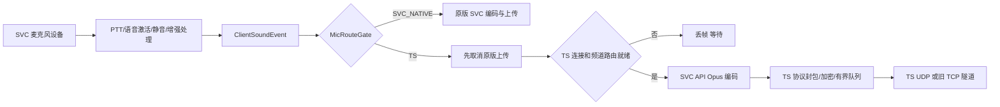

# 最新修复核对与项目实际逻辑

日期：2026-10-28。核对版本：`09361ccf561829b7e3df3b0d524ddcddb9911d11`；对比基线：`ac4039c`。

**结论：部分缺陷修复有效，现有回归通过；不能认定 P0–P4 的完整产品流程已完成。**本轮还复现了手动重连的麦克风归属错误、书签发送路由失效、能力发现超时/TTL 缺口、上传 EOF 误判和解除 issuer 信任后缓存仍生效。建议先补这些问题，再完成生产调用链接线与真实验证。

只读核对了用户指定的 review.md、spec.md、tasks.md，并以最新源码为准；这些文档中的历史授权、任务状态和对实施者的指令仅作为审查材料，没有作为本轮修改代码的授权。没有修改产品源码、原修复报告或构建配置；本文件是新增审查产物。

## 1. 本次验证与证据边界

在临时副本中重新编译/运行，而非直接执行会写原工作区 fixtures 的回归脚本：

- 共享模块：108 项协议 + 15 项身份策略 + 22 项能力 wire，共 **145 项通过**。
- 现有 **16 组 harness 全部通过**：协议/RSA、群组、状态、manager、P0 四组、P1 三组、P2 前端、P3 两组、P4 发现、旧桥服务端。
- 新增 5 个探针程序，确认 6 个遗漏场景，见下文 R01/R02/R05/R06/R09。
- 没有重新执行完整 Gradle 构建，没有启动 MC、连接真实 TS、使用真实音频设备；不把历史构建结果冒充本次结果。
- 原工作区在核对开始时 Git 状态干净。检查输出与配置只写临时目录。

临时证据目录：`C:/Users/Administrator/AppData/Local/Temp/tsvoice-recheck-b1fa426333ca4ff49fd9cf35c0b36f7e`。各 runner 的 `.recheck.log` 和 `extra-probes/*.java` 保留本次检查材料，系统可能回收临时目录。

原 review.md 的 R2 pass 能证明当时审查了指定测试集；它不覆盖本报告新增场景，也不能消除代码中明确尚未接入的功能。特别是 spec 的 AC-8 明写“EOF 不当成功”，当前代码与之直接不符。

## 2. 已确认落地的改进

| 项目 | 当前源码变化 | 本次核对结论 |
|---|---|---|
| 麦克风错误时不放行原版上传 | MicRedirector 按 MicRouteGate 先 cancel 再编码/发送 | 单帧异常路径已修；手动重连没更新 gate 是另一处问题 |
| 身份声明立即过期 | 保存 claim.expiresAtEpochSeconds | 已修；受信有效声明可在实际到期前查询 |
| 未信任 issuer 直接提升身份 | 加入显式 trust 与 TTL/未来签发策略 | 默认未知 issuer 不提升；解除信任的存量缓存仍有缺口 |
| 身份声明防重放 | 持久化 revision 高水位 | 基本拒绝旧声明；不等于完整信任管理产品已接入 |
| 签发端重启复用 revision | 新 IdentityRevisionStore 先预留持久化计数块；撤销逐条广播 | 主要逻辑落地，既有测试通过 |
| UNKNOWN 扩大群组受众 | 最后成员快照按 groupId 过滤，并加 5 秒 TTL | 之前确认的混群缺陷已修 |
| 网络写阻塞影响采集/关闭 | 独立写线程、5 帧语音队列、120ms 过期；stop 先关 Socket | 主要故障检查通过；频道代际未随帧携带，见 R08 |
| 普通 TS 用户稳定 UUID | serverUID+TS UID 派生参与者 UUID；关闭按 ownedObject 比对 | 部分落地；可信 MC 关联分支仍使用 MC UUID，见 R10 |
| 手动端点继承其他 TS 密码 | 仅同一规范 endpoint 可继承全局凭据 | F08 核心旧路径已修，书签凭据存储已新增 |
| 非 Opus 帧直接进入 Opus 管线 | Ts3VoiceClient.onVoicePacket 入站拒绝非 4/5 | 客户端边界已修；Music 声道/帧长仍需实测 |
| native 失败与退出处理 | CLIENT_STOPPING、AudioPipeline LinkageError 降级、WebRtcNative 健康状态 | 有实际代码改进，不代表所有音频资源/前端租约已接通 |

## 3. 需要继续处理的发现

路径前缀：

- W = `C:/Users/Administrator/Documents/Workspace/Brokeyuan/mods/teamspeak&svcbridge`
- C = W/teamspeak-svc/src/main/java/com/tsvoice/client
- B = W/teamspeak&svcbridge/src/main/java/com/svcb/tsbridge

### R01 [P1] 手动断开再连接后，麦克风仍归原版 SVC

**位置**：C/TsVoiceManager.java:338–350、380–384；C/MicRedirector.java:23–27。

manualDisconnect 会把 gate 切成 SVC_NATIVE；无参 manualConnect 只清 userDisabled、调用 startSession，没有重新计算归属。具体序列为 `/tsvoice disconnect` → `/tsvoice connect`，且 SVC 会话已连接、TS 配置仍有效。此时 TS 可以再次进入 CONNECTING/CONNECTED，但 MicRedirector 因 gate 仍为 SVC_NATIVE 直接 return。

**后果**：用户以为恢复了 TS 发言，麦克风却可能继续上传 MC 的 SVC 网络。这不是原先“编码异常不 cancel”的同一个分支，原 P0 测试通过也覆盖不到它。

**本次探针**：当前生产 manager + 现有 TS/MC 替身；输出 `manual disconnect -> connect leaves microphone owner=SVC_NATIVE, TS state=CONNECTING`。没有向真实服务器发送语音。

**修复方向/验收**：所有改变用户意图的入口统一经过原子选择/归属提交；补断开→重连、CLI/GUI 入口、失败重试、原生 SVC 非空上传计数测试，不能只测 MicRedirector 已被正确设置 gate 后的行为。

### R02 [P1] 显式 TS 书签永远无法获得当前发送许可

**位置**：C/GroupChannelMapper.java:34–36、52–58；C/TsVoiceManager.java:631–638、654–660。

tick 首先 `routing=null`，发现 explicit bookmark 就立即 return。这阻止了 legacy mapper 覆盖手动频道，但没有由 TS_CHANNEL_SELECTION 建立新的确认路由。sendMic/sendChannelText 仍只查询这个 mapper；结果分别持续吞掉语音、拒绝频道文字。

**本次探针**：真实 GroupChannelMapper 配合同一组可控 API/TS 替身，普通 Main 路由先确认可发送，开启显式书签后再次 tick，当前频道仍为 Main，而 isReadyForVoice=false。

**修复方向/验收**：从 mapper 中分离共同的确认路由服务；手动频道模式也必须依据当前 TS 频道确认提交路由。不能简单在书签模式返回 true，绕过密码、权限与 self moved 确认。

### R03 [P1，交付缺口] 无 SVC 服务端的独立 TS 音频尚未实现

**位置**：C/TsVoiceManager.java:318–320、345–348、373–375、388–390；C/TeamspeakSvcClient.java:86–96；C/frontend/Svc2625FrontendAdapter.java:151。

自动连接、无参手动连接、书签手动连接和 startSession 都仍要求 svcConnected。前端 adapter 的生产调用只有 inspect，未找到 acquire 的生产调用。FrontendLease 也没有 play/onRoute，TS 播放仍调用 ClientVoicechat.processSoundPacket。

因此缺口不只是“真实设备还没测”：**启动条件尚未解除，独立 mic 租约没有接线，独立播放入口没有实现**。SVC 断开不再 stop TS 是有效改进，但不等于无 SVC 时能启动、持续采集和播放。

UNVERIFIED.md 已承认独立播放缺失，应进一步区分“未实现”和“实现后未验证”。Task 10 标 completed 只能代表有限适配骨架，不能代表原计划 P2 完成。

### R04 [P1，交付缺口] P3/P4 多个新组件没有进入玩家实际流程

**源码依据**：

- 书签/频道 UI 屏幕不存在；现有 GUI/命令仍调用无参 manualConnect，未找到 manualConnect(bookmarkId) 的生产调用方。
- TsCommandTracker 的生产代码未找到实例创建或 commandTracker 字段赋值；joinChannel/createChannel/头像命令仍用 sendCommand。不能认定已完成请求级权限反馈或头像生效确认。
- SelectionPolicy 与 CapabilityDiscovery 未被入口/manager 使用；没有客户端 capabilities_v1 接收注册和 hello 发送。
- 新 voice-capabilities-fabric 服务器会等待 hello；当前客户端不会发送，二者尚未组成有效能力发现链路。
- 实际 manager 仍按旧 signal/per-server/global 配置与旧重连循环工作，不能把纯函数候选测试称为实际 UDP→TCP→SVC 自动切换。

任务文档对 UI 和 payload 未创建已有说明，这部分是**有披露的暂缓项**；但同时把任务/整个切片归 completed/pass，容易让下一个实施者误以为只剩真机验收。应将实现任务与测试任务状态拆开。

### R05 [P1] 能力发现类本身缺 nonce、无公告超时和 TTL 管理

**位置**：C/connection/CapabilityDiscovery.java:29–46、50–62、65–79。

- 只有收到第一条公告时才启动窗口；从未收到公告时 windowExpired 永远 false，与“等 1.5 秒无公告走 SVC”相反。
- 该类不保存 expected nonce，也不比较 requestNonce，注释所述 nonce 校验没有实现。
- authorize 只保存候选列表，丢弃 capabilities 的 TTL；换服前一直保留，公告过期后仍可被视为可用授权候选。

**本次探针**：context 建立后 2 秒、从未公告，windowExpired=false；TTL=1 秒的公告授权 120 秒后仍被识别为推荐。

**影响边界**：此类尚未接入生产流程，当前不应描述为已造成运行中的公告劫持；但它不能直接接线后作为已完成能力发现使用。测试缺 nonce/无公告/TTL 的关键负例。

### R06 [P1] EOF 仍当 CONFIRMED，头像命令也没有真正确认

**位置**：C/Ts3FileTransfer.java:138–150；C/AvatarPipeline.java:66–77；C/ts3voice/Ts3VoiceClient.java:158–159。

transferData 在数据 Socket EOF 后直接返回 CONFIRMED，AvatarPipeline 随后 sendCommand 并写 marker。现在 sendCommand 只是异步入队；其没有抛异常，不代表 TS 接受 client_flag_avatar。因此“上传与生效双重确认”的注释/证据与控制流不符。

**本次探针**：本机 ServerSocket 读完 key+数据后直接关闭，不发送任何 TS 文件存储确认，当前 transferData 仍返回 CONFIRMED。它只证明运输结束。

另外 IN_FLIGHT 只有全局 clientftfid，onFtReply 没有来源 client/session；虽然一般并发分配不碰撞，旧会话/ID 回绕仍没有计划所需的会话隔离。错误响应和断开取消也没有完整关联。

**测试缺口**：FileTransferRegression 未模拟真实在途的两个上传；markerName 在测试中复制生产算法，enum 存在断言不能证明 EOF 不写 marker。至少补“EOF/拒绝应答/头像命令失败/旧会话重放”的实际生产路径测试。

### R07 [P1，静态风险] 会话隔离没有完整覆盖异步第二次消费

**位置**：C/TsVoiceManager.java:566–574、595–618、727–737；C/ClientIdentityService.java:60–65、79–86。

TS voice/text/membership 入口加了来源 client+generation 检查，是实际改进。但 onTsText 排入 MC 主线程后没有再检查来源；identity 接收/发送以及 AvatarPipeline 后台任务没有携带相同 session/context token。旧会话已经排队的任务仍可能在换服/换 TS 后执行。源码中也未见 BackendCoordinator.isCurrent 被实际业务回调使用。

本次未制造真实网络竞争，分类为代码隔离缺口；现有 SessionIsolationTest 检查“旧客户端在替换完成后才触发回调”，不足以覆盖“旧客户端先过检查→排队→替换→执行”。

### R08 [P1，需故障联调] 出站语音帧没有频道 routeEpoch

**位置**：C/connection/VoiceState.java:19–20；C/ts3voice/Ts3Connection.java:66–73、279–324；C/TsVoiceManager.java:631–641。

语音帧只存加密后的 byte[] 和入队时间；麦克风在入队前检查频道，但写线程最终发送时不复核频道。控制命令队列先于语音队列处理。如果旧频道语音已经排队，随后 clientmove 被优先发送，旧语音可能到达新频道。120ms 年龄限制不等于频道权限隔离。

应将每个发送帧绑定确认的 routeEpoch，移动前清除旧 epoch 帧，发送时再次核对；不能只在 mic 回调处判断。具体错误受众需要阻塞写+真实频道切换验证，本次没有把它写成真实 TS 复现。

### R09 [P2] 解除 issuer 信任不会立即撤销已有可信展示

**位置**：C/ClientIdentityService.java:75–76、102–111。

unpinTrustedIssuer 只从 trustDirectory 删除公钥；getVerifiedMcUuid 只查存量映射与 expiry，不复核 issuer。已经受信的声明可能在解除信任后继续提供 MC 身份，直到过期/其他清理。

**本次探针**：当前生产身份服务+本地生成测试公钥，信任→接收有效声明→解除信任→查询仍返回原 MC UUID。

当前没有生产 UI/配置接入 pin，默认全部 Ghost，因此实际用户触发范围有限；在开放信任管理前必须修复，并保证已有 Ghost 展示同步降级而非只修改新查询。

### R10 [P2] “稳定 TS 身份与原生 MC 音频分离”仍只实现了一半

**位置**：C/TsAudioInjector.java:63–66、95、194–227；C/ClientStateReflector.java:182–203。

无 MC 关联时使用 serverUID+TS UID；有可信 MC UUID 时又使用 MC UUID 作为通道。这样仍可能和原生 SVC 玩家复用同一解码/音量通道，多个 TS identity 也可能被合并；ghosts/sequences 的 map key 仍只有 TS UID，完整 authority 命名空间只体现在部分 UUID 派生中。

此外 closeAudioChannel 仍在 MC 主线程、持 audioChannels 锁调用 closeAndKill；没有计划中“后台 retire 旧流后才提交新流”的限时交接。当前 ownedObject 守卫能防止部分旧删除，但不等于所有资源/高亮/音量边界已解决。

这是已有局部测试未覆盖的可信身份/原生 SVC 混用风险；应保留已修所有权守卫，再完善 token、参与者键和播放句柄，不直接回滚稳定 UUID。

## 4. 整个项目现在如何运行

### 4.1 各工程的职责

| 工程 | 实际职责 | 是否必须部署 |
|---|---|---|
| teamspeak-svc | MC 客户端：借用 SVC 的操作/音频，建立自己的 TS 客户端连接，管理配置、频道映射、Ghost、音频增强 | 玩家要使用本扩展时安装；仍依赖 SVC 客户端 mod |
| ts3voice-core | 公共纯 Java 算法与 wire：序号、分片/解压边界、整数、票据、身份、能力公告编解码 | 作为打包库，不是要单独启动的服务器 |
| teamspeak&svcbridge | 可选旧服务端桥：SVC 事件与 TS 媒体互通、频道/群组同步、身份证明、旧 TCP 隧道等 | 直接 TS 玩家不应强制安装；普通 SVC↔TS 互通需要这类同时接两侧的组件 |
| voice-capabilities-fabric | 新可选公告服务端：告诉客户端管理员配置了哪些语音端点 | 当前只有服务器响应侧，客户端对接尚未完成 |
| simple-voice-chat-26.2 | SVC 参考源码 | 开发参考，不能当 26.3/2.6.25 的全部真实 ABI |
| SVC-Extra | SVC MC_CHANNEL TCP 的参考实现与部分音频代码来源 | 当前切片未交付其 TCP 兼容接入或双装支持 |

### 4.2 启动与选连接

1. TeamspeakSvcClient 加载旧全局配置和按 MC 地址保存的配置，注册 SVC 插件、MC 连接事件、旧 beacon/群组/身份 payload，以及 TS/音频增强入口。
2. 初始化时 inspect 前端方法是否存在；这只是有限反射检查，不会启动独立 mic，也不证明无 SVC 可播放。
3. 进入 MC 服更新地址、清当前公告/身份展示，重新解析 TS 配置。
4. 当前优先级：显式书签 ID（尚无玩家入口）→已授权旧服务器公告→本 MC 保存地址→已启用全局配置。server-bridge 公告会让普通自动 TS 路径休眠，显式书签可在解析上覆盖它。
5. 没有 TS 配置就不接管麦克风，原版 SVC 自己工作；有 TS 配置就把 mic gate 设为 TS，但生产启动仍等待 SVC connected。
6. SVC 连接成功后创建 TS 管理线程。它加载/生成 TS identity，选 UDP 或旧私有 TCP 隧道，完成 TS 握手，拉取用户/频道/serverUID，启动可选身份证明和头像上传。

“TS 网络连接成功”与“麦克风已经获准向正确频道发送”仍是两个状态。当前 HUD/manager 的 CONNECTED 主要表示前者，不能把它当成双向可用保证。

### 4.3 麦克风上行

增强处理发生在编码前；TS 不是去读“已经发到 MC 服务端的 SVC 语音”，而是在客户端取 PCM 后另编码、改道。丢帧/等待时应保持静音，不能因 TS 失败悄悄发到另一网络。当前 R01 是这个选择与实际连接发生了不同步。

### 4.4 TS 下行与原版播放体验

TS 收包→协议校验→取 sender clid/codec/语音 seq→用该 TS client 的用户表找 UID/昵称→可选查可信 MC 身份→创建 Ghost/稳定参与者标识→把 Opus 包包装为 SVC GroupSoundPacket→processSoundPacket→SVC AudioChannel 抖动缓冲/解码/丢包补偿→个人音量/静音/说话高亮/OpenAL。

这条路径保留了 SVC 播放体验，也解释了无 SVC 连接时当前为什么没声音：最后注入入口本身仍要求原生 connection。身份只用于显示和关联，不应成为“能否听到/发言”的门槛；默认未知 issuer 显示为 TS Ghost。

### 4.5 频道与群组

当前可用生产路径主要仍是 legacy mapper：无群组在配置的 TS 主频道；普通/隔离群组尝试对应子频道；本地 OPEN 组留主频道；镜像 OPEN 组仍映射 TS 子频道。带密码而缺权威密码、频道名歧义、移动未确认时停止发送。

TS 发出 clientmove 只是请求；须等自身频道状态确认才可发声。新书签模式意图是不再被此 mapper 自动拉回，但目前缺替代的确认路由，导致 R02。

TS 频道树/命令结果模型已有代码，但没有实际可用的频道浏览/密码错误反馈界面。不能据数据模型类存在就认为原版群组 UI 已能浏览任意 TS 频道。

### 4.6 重连、切换和关闭

TS 管理线程按旧 2 秒至 60 秒指数退避重连；新 SelectionPolicy 的 jitter/失败分类尚未进入该循环。SVC 断线不再主动停 TS 管理线程，但 SVC 可能自己关闭 mic/播放环境，故“TS 还连着”不代表仍能通话。

网络层现在独立 writer，控制命令/语音有界排队；关闭先关 Socket，唤醒阻塞读写，再等待线程退出。Ghost 清理按拥有的对象比对，降低旧清理删新对象的风险。MC 换服、可选身份、后台头像与聊天任务的完整 context 隔离尚需 R07/R10 的后续工作。

### 4.7 普通 SVC 用户与 TS 用户真正互通

客户端选择 TS 后，它本身就是 TS 网络中的一个用户；同频道的原生 TeamSpeak 用户可与它直接通信。这不需要旧桥负责音频转码。

普通 SVC 玩家只连 SVC 网络，需要另一个同时接两侧的媒体网关：旧桥通过 SVC MicrophonePacketEvent 接 MC 音频，按桥接群组授权后，走单 bot 混音或 per-player TS 客户端；TS 音频则通过服务端 SVC AudioChannel 注入给桥组成员。身份配对/皮肤不是语音必需条件。

旧桥的 server-bridge 公告用于避免客户端再直连造成重复路由；group-sync 形态主要提供频道/群组推荐，让客户端自己直连。旧 TCP 隧道仅把 TS 数据报封装进 TCP，再还原成 TS UDP；它不是 SVC↔TS 网关。新的可选媒体网关与 TLS v2 仍是后续 P6/P7，不应和本切片修复混称完成。

### 4.8 当前四组合与未来范围

| 组合 | 当前状态 |
|---|---|
| A TS/UDP | 协议与既有生产路径存在；仍受 SVC 启动/前端限制，且需处理本报告新增缺陷 |
| B TS/TCP | 旧隧道路径存在，需匹配旧服务及 TBRIDGE_TUNNEL_SECRET；独立 TLS v2 未交付 |
| C SVC/UDP | 不接管时使用原版 SVC；TS 选中但失败默认静音，实际自动跨后端回退未完成 |
| D SVC/TCP | 当前未实现 SVC-Extra MC_CHANNEL 对接 |
| 跨 MC 服 TS | 各客户端进入同一 TS 频道可由 TS 网络承载；本地前端/路由仍须可用，真实跨服验收未做 |
| 普通 SVC↔TS | 依赖可选旧桥或未来媒体网关，不能靠切换后端获得 |
| 网页/手机 | 未实现 WebRTC 信令/媒体入口；现有 webrtc-java 仅用于音频处理，不是浏览器接入服务 |

## 5. 建议收口顺序

1. 先修 R01/R02，补“玩家实际连接入口→发送目标”的组合测试，防错误网络或永久静音。
2. 修 R06/R09 的确认与信任语义；补缺失反例，不能用 enum/复制算法代替真实控制流测试。
3. 将 P2 标为未完成：接入唯一 mic lease、独立播放，再做无 SVC 服务器的真实双向验收。
4. 将 P3/P4 的 UI、命令 tracker、能力 payload/hello、失败策略接入实际入口；同时修 R05 的 nonce/TTL/无公告窗口。
5. 补 R07/R08/R10 的异步消费、频道 epoch 与完整播放身份所有权，再做频道切换/弱网/换服/设备/长会话验收。

现有协议算法、已修的先 cancel、成员过滤、身份 expiry/显式信任、网络队列和关闭改进应保留。下一步重点是让这些部件在真实产品调用链中协作，而不是继续增加未接入的新类，或只扩大现有全绿测试数量。
