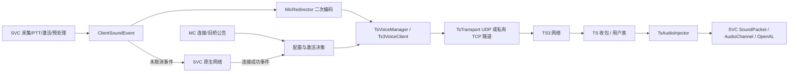
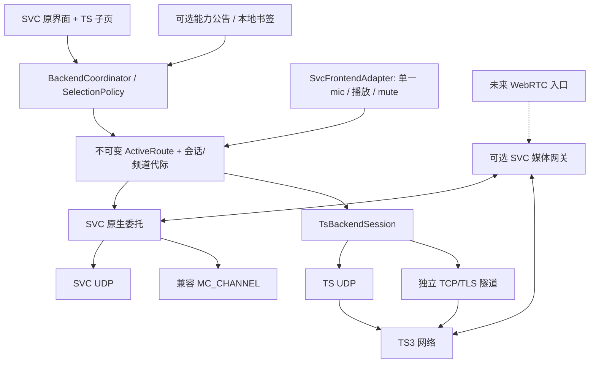

# teamspeak-svc 下一阶段架构评估

审查日期：2026-10-28（Asia/Shanghai）。状态：**供开发者审核的建议稿；不授权代码实施，不表示真实通话验收通过。**

配套文档：[实施计划](IMPLEMENTATION-PLAN.md)、[决策记录](DECISION-LOG.md)。

## 1. 结论与边界

推荐采用“**客户端双后端选择 + SVC 前端兼容适配 + 按需部署服务**”。保留已有 TS3 协议实现、SVC 界面、PTT/语音激活、Opus 和增强处理；增加统一的会话决策与单一音频路由所有权。SVC 后端继续交给原版 SVC；TS 后端独立于 SVC 服务端会话。UDP/TCP 在各自协议内部适配，不能把四种组合压成一个 Socket。

需要三个彼此独立、都非客户端强制依赖的服务能力：服务器能力公告、TS UDP-over-TCP 隧道、SVC↔TS 媒体网关。它们可以由同一安装包提供，也必须能分别启用。普通 TS 直连和手动书签不需要安装旧 tsbridge；原版 SVC 回退不需要 TS；普通 SVC 玩家与 TS 用户真正互通需要媒体接入组件，单靠客户端“切换后端”无法做到。

当前最先要解决的不是界面重写，而是：

1. TS 生命周期仍等待 SVC 语音连接；无 SVC 会话时，现有收发管线都不完整。
2. 麦克风归属依赖瞬时连接状态和发送成功，异常/重连时可能无提示进入 SVC。
3. 身份声明的客户端接入存在立即过期、信任策略未接入等缺陷。
4. 旧桥的成员未知分支会扩大接收者，且上传/频道请求、旧会话回调与 TCP 关闭仍缺完整隔离。
5. TCP 可用性、协议兼容、频道权限和真实音频质量都不能由“编译通过”推导。

本次只新增三份文档。没有改产品源码、依赖、构建配置，没有清理/删除项目文件，没有启动游戏、连接外部 TS 或改变运行中服务。

## 2. 审查基线与证据强度

### 2.1 实际基线

工作区根目录记为 **W**：`C:/Users/Administrator/Documents/Workspace/Brokeyuan/mods/teamspeak&svcbridge`。

| 名称 | 实际基线 | 本次覆盖 |
|---|---|---|
| 客户端 | W/teamspeak-svc，0.9.8；MC 26.3、Java 25、Loader 0.20.1、Fabric API 0.165.0+26.3 | 连接、麦克风、注入、频道、身份、配置、上传、关键音频处理、Mixin、构建与 CI |
| 旧桥 | W/teamspeak&svcbridge，0.3.4 | 编排、SVC 收发、成员快照、原生 TS/每玩家镜像、混音、隧道、身份、公告 |
| 公共模块 | W/ts3voice-core，0.1.0；10 个生产 Java 文件、1 个测试文件 | 全部公共协议类及测试入口 |
| SVC 参考源码 | W/simple-voice-chat-26.2 | MicThread、ClientManager、ClientVoicechat、AudioChannel、API 与群组路径；**不是当前二进制的完整源码替代物** |
| SVC 实际二进制 | W/teamspeak-svc/libs/voicechat-fabric-2.6.25+26.3.jar | javap 核对关键构造器、无连接播放门槛、麦克风启动与客户端 API 播放调用链 |
| SVC-Extra | GitHub master 固定为 `6669d6f045e6277c640efc10ea60eff30fc9bd76` | 实读网络封装、Socket、双端 Mixin、配置、音频交叉注入与构建声明 |

工作区根不是 Git 仓库，三个产品目录也未发现 `.git`；不能声称审核了某个本地提交或判断缺陷由哪个提交引入。读取了历史审查和 `.zcode/specs/unified-public-release-20261027/tasks.md`，后者只是修复意图和历史证据，不作为当前行为的最终依据。审查前记录了 131 个源码/构建/资源/文档文件的 SHA-256，交付前重核全部一致；本次工作区仅新增本目录三份交付文档，临时测试生成物不在产品目录。

关键文件 SHA-256（定位本次快照，后续修改须重核行号）：

| 文件（W 下） | SHA-256 |
|---|---|
| teamspeak-svc/src/main/java/com/tsvoice/client/TsVoiceManager.java | `811c228c61013d192f214c3b97e7f2d8506a000c97dbb543dacb444dc2465ed6` |
| teamspeak-svc/src/main/java/com/tsvoice/client/ClientIdentityService.java | `4fb3a20858134c8406731994231ee29ad6f6ba6582703e44e021b20fc6792267` |
| teamspeak-svc/src/main/java/com/tsvoice/client/MicRedirector.java | `cdbce4efa13fdd43acde3349084087419f99ae2fccc016b152be46180b8c1deb` |
| teamspeak&svcbridge/src/main/java/com/svcb/tsbridge/svc/BridgeMembershipService.java | `44c42cb35a5b8fbba54d247c122c22817d2fca5d9cb2fc520247a49782c586c5` |
| teamspeak-svc/libs/voicechat-fabric-2.6.25+26.3.jar | `189605fd1c07d582db3f243201f0435a48545f18481fb79847f1965011579407` |

### 2.2 本次实际执行的检查

复制源码和必要回归材料至临时目录，所有编译输出、测试配置和新探针仅写临时副本。未运行原目录中的构建/回归写入脚本。Java 25.0.4.1；初次读取 classpath 遇到环境的 AccessDeniedException，临时副本改用解包依赖并在获准的执行环境重跑成功；不将此前环境失败算成产品缺陷。

| 检查 | 当前结果 | 证明范围 |
|---|---|---|
| ProtocolTestMain | 108 项通过 | 公共序号、整数编码、QuickLZ、票据、声明/wire、重组、弱网与并发票据 |
| ProtocolRegression + RsaRegression | 频道表 11 项通过；RSA/握手检查通过 | 当前生产协议类 + 离线向量 |
| MapperRegression | 13 项通过 | 当前群组路由类 + TS/SVC 替身 |
| ClientStateTests | 14 项通过 | 注入/原生状态所有权、客户端替换、音频通道关闭；SVC 为替身 |
| ManagerTests | 13 项通过 | 信标授权、密码三态、未确认频道阻断；TS 为替身 |
| ServerRegression | 14 项通过 | query 清理、玩家离线提交、票据拒绝/重放、停止隧道、成员与 reload 分支 |
| 新身份探针 | 复现立即过期、缓存未获本地信任的 issuer | 当前 ClientIdentityService + 真实 core/TS 对象，Fabric/MC 为替身 |
| 新麦克风探针 | TS 已选、createEncoder 抛异常时事件未取消 | 当前 MicRedirector；不等于实际设备故障联调 |
| 新成员探针 | UNKNOWN 时把另一群组玩家加入目标列表 | 当前 BridgeMembershipService，无外部依赖 |

五组回归合计 65 项具名断言，另有 RSA/握手检查。**这些通过不覆盖真实设备、运行时 Mixin、TS 服务端兼容、TCP 阻塞、长通话、跨服回声或完整 SVC 初始化。**本次未重新执行完整 Gradle 构建；历史构建成功不作为本次功能验收。

临时证据目录：`C:/Users/Administrator/AppData/Local/Temp/teamspeak-architecture-cf644bd1b6424f3484efb460c379f7d0`。其中 `new-probes/AuditNew.java`、`new-probes/BridgeSnapshotProbe.java` 可复现新增观察；临时目录可能被系统回收，计划要求实施者将相应场景迁入正式回归。

### 2.3 判断分类

- **已验证修复**：当前源码已变化且相关离线回归通过；只覆盖列出的条件。
- **确定缺陷**：当前源码存在可达错误分支；标明是否探针复现。
- **新增实现缺陷**：相较旧报告，位于新接入的代码；无 Git 证据时不归因到具体修改者/提交。
- **运行风险**：静态分析不能定论，必须做指定联调，不能写“已支持”。

## 3. 当前架构与通信链路

当前是“**SVC 前端及会话上寄生的客户端 TS 替换路径**”，不是已经完成的双后端调度器。`MicRedirector` 取得 PCM，使用自己的 SVC API encoder 编码；并非直接拿到 SVC 已编码字节。TS 接收侧用 GroupSoundPacket 注入 SVC 内部播放，继承个人音量、静音、Opus 解码及抖动缓冲。TS 语音为等响度，不能因此承诺原版 SVC 的距离/群组全部语义。

### 3.1 明确存在的 SVC 会话耦合

位置均相对 W：

- `teamspeak-svc/.../VoicechatPluginImpl.java:43–50`：SVC 连接/断开直接启动/停止 TS。
- `TsVoiceManager.java:241–243,268–270,282–284,329–330`：自动、手动、循环运行均检查 `svcConnected`。
- 实际 SVC JAR 的 `ClientVoicechat.onVoiceChatConnected` 启动 mic；`onVoiceChatDisconnected` 关闭 mic；`processSoundPacket` 在 `connection == null` 时返回。
- JAR 中 `ClientAudioChannelImpl.play` 最终仍调用 `processSoundPacket`。仅改用公共 `createStaticAudioChannel()` 不会自动消除该门槛，也会把 Opus 处理责任转到调用方。

所以“删掉 WAITING_SVC 判定”只能让 TS 握手开始，不能恢复无 SVC 服务器环境的完整音频。独立前端适配必须同时验证采集、播放、状态和群组入口。

实际 JAR 的 `AudioChannel` 构造器是 `(ClientVoicechat, InitializationData, SoundManager, UUID)`；26.2 参考源码是三个参数。这是已证实的内部 ABI 差异。当前 mod 尚未直接调用该构造器，但未来适配不能照旧源码实现。

### 3.2 与旧桥的关系

客户端构建只有 `ts3voice-core`、Fabric、SVC 等依赖；未导入服务端 `com.svcb.tsbridge`。**不存在必须安装整个旧桥的 Java/Mod 运行依赖**。但有以下功能耦合：

- 只有旧桥目前发送 TS endpoint、`backendMode`、tunnelPort 及群组密码信息。
- `backendMode=server-bridge` 令客户端休眠，且优先于手动地址；不满足“手动选择不受推荐限制”。
- TCP 当前只能对接旧隧道协议，且客户端从环境变量取得共享根秘密。
- 带密码 SVC 群组的 TS 映射依赖成员专属 GroupInfoPayload；没有服务端信息时只能安全暂停，不能自行推导密码。
- 可验证 MC↔TS 身份声明只在当前 MC 连接内传输；不是跨服全局身份目录。

### 3.3 公共模块的实际边界

`ts3voice-core` 已共享 Seq16、PacketSequenceWindow、BoundedCommandAssembler、QuickLZ、固定宽度整数、隧道票据、签名声明、信任目录与身份 wire 格式，且零第三方依赖。**Ts3Crypt、Ts3Identity、Ts3Connection、Ts3VoiceClient 等完整 TS 栈仍是两份实现**；客户端有 TsTransport，服务端仍直接持有 DatagramSocket。不能把“公共模块已建立”写成“协议栈已全部去重”。

## 4. 上轮修复复核与当前问题

以下 `C/` 指 W/teamspeak-svc/src/main/java/com/tsvoice/client；`B/` 指 W/teamspeak&svcbridge/src/main/java/com/svcb/tsbridge；`P/` 指 W/ts3voice-core/src/main/java/com/tsvoice/protocol。

### 4.1 已有修复应保留

| 修复点 | 当前证据 | 保留要求/余留边界 |
|---|---|---|
| 命令回绕、分片与解压 | 双端 Ts3Connection 使用公共窗口/有界重组器；core 108 项 | 保留认证成功后才更新窗口、重复包仍 ACK、大小/片数/年龄限制；不把模型测试当成真实 TS 抓包验证 |
| RSA 高位、握手点校验 | 双端 Ts3Crypt.solveRsaChallenge 用 UnsignedIntegers；公钥使用 validatePoint；RSA 检查通过 | 不回滚成 BigInteger.toByteArray 的可变宽结果 |
| 信标凭据隔离 | C/TsVoiceManager:178–198，首次端点授权，信标不继承密码；manager 回归通过 | 手动端点间的全局密码继承仍有问题，见 F08 |
| 群组发送保护 | C/GroupChannelMapper:34–49,89–119；每帧检查群组/确认频道 | 不超时回公共频道，不以提交 clientmove 代替 TS 确认；OPEN 群例外要保留 |
| SVC 对象更新和 Ghost 所有权 | C/TsAudioInjector 每次获取当前 SVC client；ClientStateReflector 的 ownedStates；14 项通过 | 状态所有权与音频通道所有权还需分离，真实重连队列需测试 |
| 隧道鉴权与停止 | B/net/TcpTunnelServer:43–58,137–146；票据一次性消费、默认 loopback、32 会话、stop 全关 | 不能再描述为完全无认证；不等于已适合多用户公网部署 |
| 服务端上传调度/混音清理 | PlayerVoiceClients 独立发送线程/有界队列；McAudioMixer 先停线程、finally 关 native，最终一次 clamp | 队列缺路由 epoch/时效、正确频道提交仍需补齐 |
| AEC 同步写回与增强默认关闭 | C/audio/AecProcessor:84–113；ModConfig:94–104 | 保持现有可用 DSP，不能宣称多人参考已精确混合 |
| 上传结果分类 | C/Ts3FileTransfer.Result 与 AvatarPipeline 只对 CONFIRMED 写 marker | EOF 确认强度、请求关联和头像 namespace 仍不足 |
| CI 和标准 core 测试 | W/.github/workflows/ci.yml，core test→protocolTest | 旧报告“完全没有 CI/正式测试”已不成立；客户端/服务端大量测试仍为替身 |

### 4.2 当前确定缺陷与高优先级风险

优先级：P0 为语音接收者/身份信任边界；P1 为核心可用性与资源隔离；P2 为兼容维护。这里列的是实施输入，本阶段不修复。

| ID | 级别/分类 | 位置、触发条件、后果 | 建议与验证 |
|---|---|---|---|
| F01 | P1，需求差距，静态确认 | C/VoicechatPluginImpl:43–50；TsVoiceManager:241–243,268–284,329–330；无 SVC 会话或其 UDP 不通时，手动 TS 也等待/停止 | 独立 TS 生命周期 + 前端适配验证门；无 SVC mod 的 MC 服务器双向真实通话 |
| F02 | P0，确定缺陷，探针复现 | C/MicRedirector:21–40；TS 选中但编码异常、encode 返回空或检查后 TS 断开，未 cancel；连接未好时直接放行 SVC | 按用户选中的路由先消费事件，失败只丢帧并反馈；测试编码异常、断线竞争、重连、长按 PTT 无跨网发声 |
| F03 | P1，会话隔离缺口，静态可达 | C/TsVoiceManager:447–450,477–482,627–646：旧 client 回调不携带 generation，接收时查询全局新 client；相同 clid 可被错认，新会话 Ghost 可被旧回调刷新 | 闭包绑定 SessionToken/client，入队和消费双检；延迟旧 voice/text/membership/proof/avatar 回复测试 |
| F04 | P1，新增身份接入确定缺陷，探针复现 | C/ClientIdentityService:127 把 `now` 存入 expiresAt；78–85 在当前秒就视为过期 | 存 claim.expiresAtEpochSeconds；未来/到期边界、秒切换、刷新测试 |
| F05 | P0，新增身份信任缺口，探针观察 | C/ClientIdentityService:114–128 从同包公钥验签就缓存为 verified，未使用 P/ServerTrustDirectory 的显式信任；51–53 撤销仅删除，没有 revision 墓碑。修 F04 后会暴露可用的自签映射；撤销后重放旧声明可重新入库 | 明确信任来自本地 pin/联盟目录；未信任只显示 Ghost；撤销高水位、跨 issuer 冲突、未来签发与 TTL 上限测试。当前 F04 使映射失效，不能声称现已成功冒充 |
| F06 | P0，旧桥确定缺陷，探针复现 | B/svc/BridgeMembershipService:55–56；BeaconSender:142–143 发布所有群组成员；读状态失败后返回全部 key，A 群音频目标包含 B 群成员 | UNKNOWN 仍按请求群过滤最后快照，并设置快照 TTL；过期禁止发送。替身旧测试只覆盖单一群，未发现扩大 |
| F07 | P0，旧桥迁移阻断，静态确认 | B/transport/PlayerVoiceClients:212–217 和 Ts3NativeTransport:320–326 只检查 connected；join 请求异步，进入默认频道、权限拒绝或被移动后仍发送；NativeTransport:233–235 还立即标记 joined | 发出与取队列帧时都核对目标 cid/routeEpoch/确认状态；错误频道不发。向旧桥复用代码前补真实拒绝/移动测试 |
| F08 | P1，确定凭据设计缺口 | C/TsVoiceManager:200–215 与 ServerConfigStore.Entry；为另一个手动 host 配置但密码字段为 null 时，继承全局其他 TS 的密码 | 凭据按规范 endpoint/bookmark 隔离；迁移时不得自动复制到不匹配端点；密码保留空格和显式清除语义 |
| F09 | P1，阻塞路径风险，需故障测试 | C/Ts3Connection:157–170,222–225 持 sendLock 执行 TCP write；stop:141–145 要同锁才能关 Socket，disconnect:325–333 先发命令；TCP 对端停止读可令关闭排在永不完成写后。manager CLOSE_EXECUTOR 只是转移阻塞 | 关闭先原子失效并直接关闭 Socket，写在独立有界队列；黑洞写测试必须在限时内退出。不能据当前回归宣称已完全解决 |
| F10 | P1，上传隔离确定缺口 | C/Ts3FileTransfer:48–83 单个 handler，未核对 clientftfid；两个上传/旧回复可覆盖与串用；95–96 EOF 只证明流结束；AvatarPipeline:49,64,184 按 server namespace+MC UUID，漏 TS UID/皮肤版本 | Future 按 session/requestId 关联；UNKNOWN 不写成功；必要时查询文件/头像命令确认；覆盖错误响应、并发、迟到、换身份和皮肤 |
| F11 | P1，codec 防线缺口 | C/TsAudioInjector:99–110 对非 4/5 只警告仍送 Opus；双端 Ts3VoiceClient.onVoicePacket 不拒绝；旧桥 Ts3NativeTransport:287 丢掉 codec/原始 seq | 入站明确拒绝不支持 codec，错误可见但不中断其他用户；Opus Music 声道/10–100ms 包需实测；网关帧保留 codec+原始序号 |
| F12 | P2，资源/降级风险 | C/MicRedirector.encoder 静态无关闭入口；TeamspeakSvcClient 无 CLIENT_STOPPING 资源编排；AudioPipeline:48,61 仅捕获 Exception，native linkage Error 可逸出；WebRtcNative:65–68 处理失败只逐帧记录，isNsActive 仍 true | 所有者在退出/重配关闭 native；健康状态反映处理失败，避免原生 NS 被持续禁用；设备/动态库失败注入测试 |

F02/F06/F07 涉及语音接收者变化，应优先于新增自动回退和网关复用。F04/F05 不能只单独修 TTL 后就宣告身份安全。

身份防重放的实施约束还涉及签发端：B/identity/IdentityProofService:53 的 revision 当前从 AtomicLong(1) 开始，而签发公钥跨重启保留。引入持久撤销高水位后，必须同时让签发 revision 跨重启单调，否则合法重新证明可能永远低于旧墓碑。实施计划指定先持久化再发布的计数器与“签发→撤销→重启→重新证明”回归；这属于设计接入约束，不能误称现有客户端已具备完整防重放机制。

其他已读到的限制：主频道按名称全局查找虽然已拒绝歧义，仍不能稳定表示跨虚拟服务器频道；GroupChannelMapper 的手工选择会被周期性映射覆盖；异步创建仅有一个 pendingCreateName；错误通知在 Ts3VoiceClient.handleError:788–799 主要写日志，GUI 无请求级权限结果。TS 握手成功不代表“可发言/可听/已进入指定频道”。

### 4.3 音频、线程和性能判断

现有同步 AudioPipeline 类锁保障配置切换时不在途销毁 native，不能在没有替代生命周期方案时直接删锁。改进方向是短时配置提交与单独音频所有者，测量后再决定是否替换成不可变 AudioGraph。

AEC 参考目前是多个 speaker 的 PCM 按到达顺序入队，未按播放时钟、音量、静音和声道做真实输出混合；MAX_FRAMES=50 只限制长度，不能保证时间对齐。`AlSpeakerMixin.writeSync` 在底层输出前取参考；不能承诺真实扬声器回声消除收益。维持默认关闭，采样实际输出/近端双讲做 ERLE 与音质测量后独立改进。

同一个 SVC AudioChannel/PlayerState UUID 同时承载原生 SVC 和 TS 音源会造成音量、解码状态或清理所有权混杂。`GhostAudio.ownsState` 不是 `ownsAudioChannel`。未来必须拆分稳定参与者键、播放通道键和可选 MC 展示身份；切换 epoch 后绝不让旧清理删新通道。

实际 2.6.25 的 AudioChannel.writeToSpeaker 仍按通道 UUID 查询 USERNAME_CACHE/PLAYER_VOLUME_CONFIG、更新 TalkCache。推荐稳定 TS 展示/音量 UUID（含 serverUID+TS UID），会话/stream 所有权另存，不把重连代际放进该持久音量 UUID。通道 registry 用 token+ownedObject 防旧清理，保留同 UUID 重连的个人音量；不能仅创建随机新播放 UUID 后声称原版音量自然生效。

TS 收线程当前还处理用户显示回调、SVC 注入，麦克风回调同步编码/TS 发送；TCP 堵塞会直接卡采集。先有界排队、过期丢帧、会话标识，再按 profiling 判断是否需要专门音频池；不把每帧任务塞到 MC 主线程。GUI/state 变更上主线程，OpenAL/codec 使用其规定线程，网络回调不等待主线程。

## 5. 四种组合的真实含义

| 模式 | 链路与部署 | 当前程度 | 下一阶段边界 |
|---|---|---|---|
| A TS3/UDP | 客户端 TS 协议栈→TS3 UDP；MC 服可没有任何语音组件 | 协议存在，但生产激活/音频依赖 SVC 会话 | 完成前端独立适配后可支持无 SVC 服务器；跨 MC 服共用 TS 频道自然互听，无需 SVC 跨服路由 |
| B TS3/TCP | 客户端 TS 完整包→鉴权 TCP/TLS 隧道→TS UDP | 私有帧协议及旧桥服务已存在，尚非独立可配置产品 | 隧道目标、TLS/认证和版本协商分开配置；网关到 TS 的 UDP 必须可用；手动 TS 书签需独立隧道端点和凭证 |
| C SVC/UDP | SVC 客户端→SVC 服务端 UDP | 未接管时交还原版 SVC | 原版服务端仍必须有 SVC；纯客户端无法令没有 SVC 的 MC 服提供 SVC 服务 |
| D SVC/TCP | 原版 SVC 报文→svc-extra:voice→MC TCP→SVC Server.addRawPacket | 本项目尚未实现，SVC-Extra 参考实现存在 | 必须有兼容服务端组件/协议；本项目客户端不能单方面把普通 SVC 服务端变成 TCP；不共用 TS 隧道 |

[TeamSpeak 官方端口表](https://support.teamspeak.com/hc/en-us/articles/360002712257-Which-ports-does-the-TeamSpeak-3-server-use) 区分语音 UDP 与文件传输/ServerQuery TCP；这些 TCP 端口不是 TS 语音替代品。B 模式是特定隧道的兼容承诺，不是 TS3 原生 TCP 语音。

TCP 的可靠顺序传输会出现队头阻塞；加 TCP_NODELAY 或优先级队列无法消除链路丢包重传的等待。允许在 UDP 受限时使用，不宣传延迟更低。当前 TS 出站语音设置 FLAG_UNENCRYPTED，隧道鉴权也不提供内容加密；不能假定“TS 协议已经加密所以不需要 TLS”。TS 强制加密频道的实际兼容性须测。

## 6. SVC-Extra 源码兼容评估

以下链接均固定到已读取提交，结论针对该快照，不泛化到未来版本。

| 路径（SVC-Extra 仓库下） | 实际行为与影响 |
|---|---|
| [VoicePayload.java](https://github.com/liuyuexiaoyu1/SVC-Extra/blob/6669d6f045e6277c640efc10ea60eff30fc9bd76/src/main/java/com/liuyue/svcextra/network/VoicePayload.java) | `svc-extra:voice`；encode 直接 writeBytes，decode 读取该 payload 剩余全部字节，无额外长度、版本或 TS 字段。MC 层负责外框；载荷为完整 SVC NetworkMessage，不是裸 Opus |
| [McChannelClientSocket.java](https://github.com/liuyuexiaoyu1/SVC-Extra/blob/6669d6f045e6277c640efc10ea60eff30fc9bd76/src/client/java/com/liuyue/svcextra/client/audio/McChannelClientSocket.java) | send 忽略 UDP address，走当前 MC conn；read 消费静态无界 globalQueue；close 只 clear；isClosed 永远 false；阻塞 take 无自己的关闭唤醒，跨连接共享队列 |
| [ClientConnectionMixin.java](https://github.com/liuyuexiaoyu1/SVC-Extra/blob/6669d6f045e6277c640efc10ea60eff30fc9bd76/src/client/java/com/liuyue/svcextra/client/mixin/ClientConnectionMixin.java) | 在 ClientVoicechatConnection 构造完成后改写 final socket；基于全局配置判断，不是初始化事件中协商；旧 socket 在该方法中未显式关闭，是否产生已打开资源取决于目标 SVC 构造路径 |
| [PacketUtil.java](https://github.com/liuyuexiaoyu1/SVC-Extra/blob/6669d6f045e6277c640efc10ea60eff30fc9bd76/src/main/java/com/liuyue/svcextra/network/PacketUtil.java) | 两向注册 voice；C2S 直接构造 RawUdpPacketImpl 并 addRawPacket；虚拟地址为 `mc:abs(UUID.hashCode()%65535)`，存在碰撞空间，不是唯一 UUID 地址 |
| [McChannelMixin.java](https://github.com/liuyuexiaoyu1/SVC-Extra/blob/6669d6f045e6277c640efc10ea60eff30fc9bd76/src/main/java/com/liuyue/svcextra/mixin/McChannelMixin.java) | 拦 Server.sendPacketRaw；用 NetworkMessage.writeServer 保留 SVC 封装/密钥语义；发 MC payload 后 cancel；判断是服务端全局 transport，而非每玩家协商 |
| [VoiceConfigPayload.java](https://github.com/liuyuexiaoyu1/SVC-Extra/blob/6669d6f045e6277c640efc10ea60eff30fc9bd76/src/main/java/com/liuyue/svcextra/network/VoiceConfigPayload.java)、ServerVoiceEventsMixin、SvcExtraClient | `svc-extra:config` 只有 UTF transport 字符串；在 initializePlayerConnection 尾部发送；客户端直接 enum.valueOf 后改全局配置。没有 hello/ack、版本、最大帧、混装能力表；config 与 SVC secret 导致建 Socket 的先后需要实测 |
| gradle.properties / fabric.mod.json | 目标 MC 26.2、Loader 0.19.3；本项目为 26.3。不能把原版 26.2 JAR 的“双装测试”列成 26.3 可直接执行的安装组合 |

推荐分两步兼容：

1. 优先支持“本项目客户端 + 兼容 SVC-Extra 服务端”的 D 模式：精确复用两个 payload ID/字节格式，由 SVC 公共初始化事件设置自有 `ClientVoicechatSocket`。使用会话级有界队列、closed 标记和唤醒信号，保留 SVC 加密与认证过程；不复制有缺陷的静态队列。
2. 双客户端同装必须有明确所有者策略。检测 `svc-extra` 后，本项目不重复注册相同 payload、替换 socket 或重复处理相同 DSP。若对方没有可复用扩展 API，提供受版本约束的集成桥；尚未验证的版本显式关闭 D 自动接管，并显示兼容原因。不能靠 Mixin priority 碰运气。所需最小上游协作/兼容补丁作为独立决策。

[SVC 官方 API](https://voicechat.modrepo.de/de/maxhenkel/voicechat/api/events/ClientVoicechatInitializationEvent.html) 已提供设置客户端 Socket 的入口；优先使用它。初始化事件能否先于 Extra 的 config 决策，需要目标版生命周期测试；推荐自有 delegating Socket 在 open 前绑定 transport，错过时仅重建 SVC 连接，不能悄悄热换正在收发的 socket。

双装的其他风险：两者都在 MicrophoneProcessor.preprocess/useDenoiser、ALSpeakerBase.writeSync/OpenAL effects、游戏音量与混响进行处理；会双重降噪/AGC/AEC、争用 aux send、重复压低音量。Extra 的 AudioChannelMixin 修改抖动缓冲，本项目的 AlSpeakerMixin 修改扬声器缓冲，二者不是同一层，仍可能累计延迟变化。webrtc-java 版本相同也不能证明 native 单例/加载方式安全。UI 按钮位置、皮肤注入和严格 require Mixin 同样需目标平台验证。

## 7. 最终体验与当前差距

| 需求 | 可保留 | 必须新增/调整 |
|---|---|---|
| 原版界面/快捷键/PTT/激活/设备 | SVC 原界面与处理器，已有 TS/Extra 按钮 | 独立前端生命周期、无 SVC 连接的状态展示、运行能力自检 |
| 书签与手动连接 | ConfigScreen 和每 MC 服务器配置 | 真正独立的多 TS 书签；endpoint/凭据/identity 独立保存；手动优先于公告 |
| 原版 SVC 回退 | 不接管时 SVC 原链路 | 显式状态机和路由静音门；不能以 isConnected=false 隐式切网 |
| TS 频道浏览与切换 | 已有频道解析、父节点、歧义拒绝、clientmove | 不可变完整频道树/状态；以 serverUID+cid 选择；请求结果关联与权限/密码提示 |
| 群组交互习惯 | SVC 群组 UI、现有映射保护、OPEN 特例 | TS 模式下使用同类列表交互显示 TS 频道；无 SVC 服务器时不能发送 SVC Create/JoinGroupPacket 冒充成功；需要适配列表数据源/动作，或专用 TS 子页 |
| TS 用户与个人音量 | SVC 播放/音量、Ghost 展示 | 稳定 ParticipantKey 与音频所有权，不按昵称/MC UUID 当主键；不能只显示说过话的用户 |
| 跨服 TS 交流 | 同一 TS 网络和频道即可承载 | 独立 MC context；跨服身份声明是另一个问题，无可信身份仍须能说话 |
| 普通 SVC↔TS | 旧桥提供可复用模型 | 可选媒体网关、权限和回声去重；四模式切换本身不完成互通 |

不重做整套 SVC GUI。维持当前按钮，TS 子页负责书签/频道/状态；原版群组页在 SVC 模式原样工作。TS 模式在群组入口附近明确标为“TeamSpeak 频道”，不能把 SVC NORMAL/ISOLATED/OPEN 语义强行映射为 TS 权限。若必须完整复用原群组列表外观，实施阶段先验证数据源/按钮状态的适配点，成本高于单独 TS 子页，见 D03。

## 8. 多后端设计方案比较

| 方案 | 优点 | 代价/约束 | 适合范围 |
|---|---|---|---|
| S1：客户端直连为主，服务能力可选（推荐） | 无 TS 配置时保留原版 SVC；书签独立；TS 接原生用户无需 MC 插件；可逐步增加 B/D/网关 | 无 SVC 会话的前端适配依赖有限 SVC 内部 API；需 pin 版本与真实回归；双装要处理所有者 | 当前目标，分阶段可交付 |
| S2：客户端统一连中心媒体网关，网关接 TS/SVC/WebRTC | 身份、房间、传输、浏览器接入更集中；客户端协议较少 | 所有 TS 通话也依赖网关，额外延迟、运维、带宽、信任与故障点；原版 SVC 仍需服务端入口；手动任意 TS 支持变成网关凭据管理 | 已决定运营统一跨平台平台时才值得 |
| S3：保留 SVC 服务端会话作所有模式前提 | 当前改动最小、可快速增 UI | 不满足无 SVC 的手动 TS、SVC UDP 断时 TS 独立性；把辅助服务变强制条件 | 可作为有明确限制的过渡测试，不能作为最终架构 |

选择 S1。没有理由为了统一四种传输重写稳定的 SVC 协议或立即合并两个 Loom 工程。新增协调器只管理选择/生命周期/媒体归属；不要定义一个包罗身份、DSP、权限、GUI 的巨大 VoiceBackend 接口。

SOLID 重点是高层路由不依赖某个协议的命令字符串、UI 不操作 Socket、资源由会话持有。`Ts3Crypt` 等稳定算法类不因“职责看起来多”而拆碎；两个连接实现共同的纯协议部分在回归可覆盖时逐步抽取。SVC backend 是委托适配器，不另造一个 SVC 客户端。

| 原则 | 当前观察 | 合理调整 |
|---|---|---|
| SRP | TsVoiceManager 同时解析配置、决定后端、管网络、身份和头像；旧桥入口承担更多全局编排 | 先分离选择/会话/前端所有权，协议算法保留聚合 |
| OCP | transport 用 boolean tcp，扩展时会将认证/端点差异塞回管理器 | TS 内注入 Transport；SVC 用原生适配，不设计通用 Socket 工厂覆盖四模式 |
| LSP | Socket 替换必须满足关闭唤醒、isClosed、单报文边界；Extra 当前实现不完全满足这些生命周期预期 | 明确契约并用同组测试检查 UDP/MC_CHANNEL/隧道；不只检查接口能编译 |
| ISP | 后端连接、用户列表、媒体收发、频道权限可用性不相同 | 小范围事件/会话接口，缺能力显式 UNKNOWN/UNSUPPORTED；不要求 SVC 实现 TS 命令 |
| DIP | GUI、DSP 与全局静态 TS manager 相连，旧桥大量静态服务定位 | 主线程协调器发布不可变状态，GUI 读模型，媒体只读 route；不引入依赖注入框架 |

维护优先级是行为边界与故障测试，而非类数量。候选状态更新频率低，可在主线程串行处理；网络/音频热路径不得等待 UI 或持有全局配置锁做 I/O。共享 core 的版本化 wire 与协议测试能减少修复漂移，但不替代目标 SVC 二进制的 ABI/运行时兼容检查。

## 9. 推荐目标架构与策略

### 9.1 选择与发现

用户意图单独保存：AUTO、PINNED_TS、PINNED_SVC、OFF；transport 单独为 AUTO/UDP_ONLY/TCP_ONLY。优先级为当前显式操作 > 已选书签 > 本 MC 保存的策略 > 已授权公告 > 原版 SVC。服务端不能覆盖显式手动连接，包括旧 `server-bridge` 公告。该公告只作为重复桥接提示/能力提示。

能力公告不证明端点在线。新协议有版本、nonce、MC context、TTL、候选 TS/隧道、SVC MC_CHANNEL 能力及协议版本；旧 beacon 只作为 legacy recommendation，不能推断 TLS、票据、健康或身份信任。只在 Fabric 声明能接收时发送自有 hello；不向任意端口扫描，不向 TS TCP voicePort 假探测。无响应意味着“未知/未声明”，不是“UDP 被封”。

进入世界可给公告 1.5 秒的有界收集窗口（建议初值，待测）。原版 SVC 的初始化不被全局挂起；无 TS 公告时尽快提交 SVC。迟到公告若将改变当前语音网络，显示提示，并在本次发言结束/重新按 PTT 后切换；不能切走正在说的话。

同一 TS endpoint UDP 失败后，只有存在兼容隧道信息且已授权时才试 B；SVC UDP 失败后，只有已协商 MC_CHANNEL 才试 D。密码错、被 ban、权限拒绝、版本不匹配不归类 UDP 失败。TS 握手的密码错误不能通过回退另一网络“解决”。

AUTO 首次选网失败可按预先可见策略回退 SVC；运行中切换必须有清晰通知、关闭旧发送、丢弃旧队列，PTT 须松开再按，语音激活须经过静音边界。PINNED_TS 默认不自动改到 SVC。UDP/TCP 同后端切换也重建协议会话，不在同一加密会话中直接换 Socket。

### 9.2 生命周期与媒体

一个协调器串行处理策略，一个 active transmission owner。分开 MC contextEpoch、backend sessionEpoch、routeEpoch，消息携带 token；旧回调只能关闭自己的资源。SVC 可以保持控制连接获取群组信息，但 TS 活跃时不得再向 SVC 上传麦克风，也不得无意播放另一网络的语音。是否允许双听是单独产品决策，首期默认单后端。

手动 TS 连接跨 MC 换服保留目标和 TS 网络会话；SVC secret、公告与可选身份绑定随 MC context 重置。退出世界默认暂停采集/播放；是否在主菜单保持 TS 音频不在首期默认启用。SVC 连接变化不能再直接 stop TS，除非前端资源确实不可用，届时显示 FRONTEND_UNAVAILABLE 而非伪装 TS 断网。

`SvcFrontendAdapter` 必须先通过阶段 P2 验证：复用 SVC MicThread 的 null connection 支持、前处理/PTT/设备；在真实 SVC mic 已存在时不能启动第二个；对拥有 token 的 TS 包使用独立的受限播放入口。不能全局伪造 SVC 已联网、生成网络 secret 或绕过所有原版收包门槛。26.3 播放适配是否可用 null InitializationData 必须检查所有实际引用并真实测试；若失败，采用受限的本地播放上下文适配或提出上游扩展，不能降级为强制安装服务端后称需求完成。

### 9.3 TS 隧道

保留 v1 帧与票据用于受控旧部署迁移；普通书签新增 tunnel endpoint/auth/版本，与 TS endpoint 分离。当前所有客户端拥有同一个 HMAC 根秘密、可自行签票，不适合作为多人公网授权模型。推荐 v2 TLS + 网关独立身份认证后颁发短时、绑定目标与客户端的票据；网关私钥/根秘密不发给玩家。手动书签用户可用网关独立凭证，无需 MC 服务器。

v2 服务应独立于 Fabric/SVC，可从旧 TcpTunnelServer 抽取行为；有独立会话/IP/速率上限、帧长上限、短握手 deadline、双向存活与可取消写。TLS 不解决 TCP 队头阻塞。隧道不解 TS 用户权限，不获得 TS ServerQuery 管理权，固定 allowlist 目标。

## 10. TS/SVC 真正互通与未来跨平台

### 10.1 两类通信必须分开

teamspeak-svc 玩家通过 A/B 已经是 TS 网络中的客户端，和原生 TS 用户同频道直接通话，逻辑上不需要 SVC↔TS 转码网关。普通 SVC 玩家只与 SVC 服务端收发，必须有组件同时接入两侧；推荐可选 Fabric 服务端 SVC 插件，媒体处理可放同进程或独立 sidecar。TS 隧道只转包，不承担跨协议转换。

### 10.2 最低可用网关

优先一个显式加入的 **SVC 桥接群组 ↔ 一个固定 TS serverUID/cid**。默认使用单 bot，MC→TS 多人混音（单人 Opus 可透传）、TS→SVC 每说话者独立通道；已有 McAudioMixer/McAudioInjector/Dispatcher 是参考材料，先解决 F06/F07 再复用。初期不桥接全服距离语音，不镜像所有频道，不要求配对/身份签名才能讲话。

单人 Opus 透传只适用于双方实际 packet duration、采样率/声道、codec 相容；多人混音需要每源解码→按 20ms 时间片对齐→求和/限幅→编码。TS→SVC 若可直接 `StaticAudioChannel.send(opus)`，可避免额外编解码，但需要补原始序号、乱序/丢包及帧时长验证；现有 decode/rechunk/reencode 可作为保守参考，不能声称零转码。非 Opus 先明确拒绝，不擅自解释为 Opus。

权限在发送与出队时按当前成员快照再次校验。UNKNOWN 保留的快照也须按目标群过滤且有 TTL；过期停发。单 bot 的 TS 权限是 bot 的权限，不等同于每个 MC 玩家；需要逐玩家 TS ACL/说话权时再选择 per-player 模式。每玩家镜像消耗 TS 槽位、连接、身份文件、线程和带宽，且默认连接所有 SVC 玩家并不等于都愿意加入桥，不能照搬为默认。

防循环不靠昵称或 description：登记本部署所有媒体出口 TS UID/受信网关 UID、注入来源和活动客户端路由。直连 TS 的 mod 玩家不应同时被 SVC 网关代理；服务端需协商其发送/接收归属，未协商时采用固定“仅桥接群组走 SVC”策略。**本地**出口 TS 回包拒绝注入；受信**远端**网关出口则只下行给本地 SVC，绝不重新上行 TS。全局屏蔽所有网关 UID 会令不同 MC 服的普通 SVC 玩家互听失败。MVP 固定单媒体网关；多网关扩展必须另行批准并验证转发表、远端可达和无循环。客户端直接 TS 跨服通话不受此限制。TS 原生语音不能携带任意自定义 origin 元数据，不能靠画一个 origin 字段就解决跨 TS 回声。

带宽初算：每流 Opus 码率 r，活跃流 m，接收者 n，SVC 分发可能约 m×n×r，另加封装开销；TS bot 下行收所有 TS 说话者，混音上行约一流。per-player TS 连接方案增加 TS 分发量。延迟拆成采集、帧聚合、各侧队列、网络、抖动缓冲、混音、播放，必须分别计量 p50/p95；不写没有数据的固定总延迟承诺。

### 10.3 长期理想模型

参与者键 `(backend, authority/serverUID, nativeUserId)`；TS UID 是服务器命名空间内身份，clid 只在会话内有效；频道键 `(backend, authority/serverUID, nativeChannelId)`。MC UUID 是带信任等级/有效期/issuer 的可选关联，不能当所有人的主键。播放通道另有 session/stream 标识，避免换服/换 TS 同 UID 串状态。

未来 WebRTC 入口另建认证、信令、ICE/STUN/TURN、DTLS-SRTP、拥塞控制及浏览器权限，网关处理 RTP 时钟/序号与 TS/SVC 帧差异；共享 Opus 不等于字节直接转发。见 [RFC 8835](https://www.rfc-editor.org/rfc/rfc8835.html)。现有 webrtc-java 只用于 AudioProcessing，未实现浏览器接入。现在只规范 ID/codec/帧时钟/权限边界，不提前建设完整 SFU、全局账号或移动客户端。

## 11. 兼容、部署与暂缓项

当前 fabric.mod.json 允许 voicechat >=2.6.20，但内部反射/Mixin 依据 2.6.25；defaultRequire=0 会让重要 hook 无声失效。建议先声明真实验证范围 MC 26.3 / SVC 2.6.25，再逐版扩展；核心路由 hook 失败禁用 TS 并明确告警，原版 SVC 在未接管时仍可用。不要扩大到所有 2.6.x，也不要让可选皮肤失败拖垮语音。

无必要地强制服务端组件、重写 GUI、重写 SVC 协议、全目录复制共享 TS 栈、让所有频道自动创建/公开映射、同时发两网、自动继承他服密码、未验证 native ABI 优化、先做 WebRTC/SFU、通过 ServerQuery TCP 发送语音，均不建议本阶段实施。

许可只记录工程事实：音频代码已有 SVC-Extra/Channel 移植说明；公共模块声明双许可；服务端通知仍要求核实 TSLib/TS3AudioBot 来源。迁移每个源文件须保留来源并检查上游实际许可证，不以现有 MIT/GPL 标签自动推导可重新许可。公开发布前完成专门来源/分发审查；本报告不提供未经核实的法律结论。

实施顺序：**基线与缺陷回归 → 路由/会话隔离 → 独立 SVC 前端验证 → 书签/频道/状态 → 能力发现及受控回退 → SVC TCP 兼容 → 独立 TS 隧道 → 可选互通网关 → 真实发布验收**。完整文件、接口、测试和回滚见实施计划；开发者审核三份文档后才进入产品代码实施。
