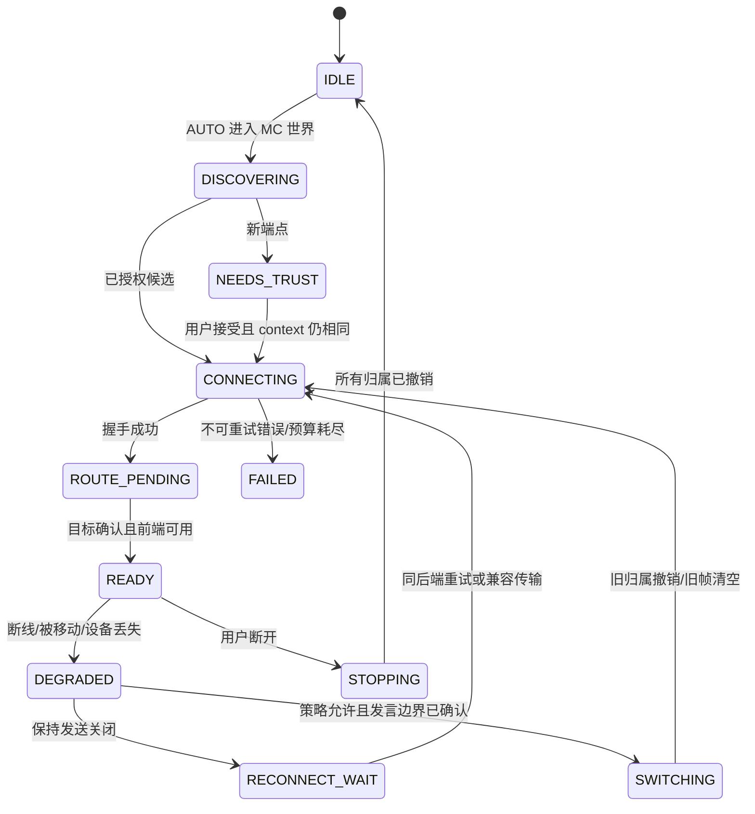

# teamspeak-svc 下一阶段 Implementation Plan

> **For agentic workers:** 开发者批准本方案后，使用 `superpowers:executing-plans` 按任务执行；若明确采用代理分工，可用 `superpowers:subagent-driven-development`。勾选项只在具有所列证据时完成。本文件当前是交接计划，不是代码实施授权。

**Goal:** 保留 SVC 操作与现有音频能力，使客户端能独立选择 TS/SVC，并分别支持 UDP/兼容 TCP，随后按需提供普通 SVC↔TS 互通。

**Architecture:** 客户端协调器决定活动后端与唯一麦克风/播放路由；SVC 网络交给原版 SVC，TS 网络沿用现有协议栈。SVC 前端独立适配先验证再扩展；能力公告、TS 隧道、跨协议媒体网关分别可选部署。

**Tech Stack:** 当前 MC 26.3、Java 25、Fabric Loader 0.20.1、Fabric API 0.165.0+26.3、SVC 实际参考 2.6.25、voicechat-api 2.6.20、ts3voice-core 0.1.0、Gradle 9.5.1/Loom 1.17.21。新增依赖只能由实施阶段相应任务说明并审核，不能在架构准备中先安装。

**Spec:** [ARCHITECTURE-ASSESSMENT.md](ARCHITECTURE-ASSESSMENT.md)；产品取舍及阻塞条件见 [DECISION-LOG.md](DECISION-LOG.md)。

## 0. 全局约束、路径与验收规则

工作区 W = `C:/Users/Administrator/Documents/Workspace/Brokeyuan/mods/teamspeak&svcbridge`。以下采用明确路径前缀，`C + connection/X.java` 表示该绝对源码目录下的精确文件，不表示已有文件：

| 前缀 | 绝对目录 |
|---|---|
| C | W/teamspeak-svc/src/main/java/com/tsvoice/client |
| CT | W/teamspeak-svc/src/test/java/com/tsvoice/client |
| CR | W/teamspeak-svc/src/main/resources |
| B | W/teamspeak&svcbridge/src/main/java/com/svcb/tsbridge |
| P | W/ts3voice-core/src/main/java/com/tsvoice/protocol |
| PT | W/ts3voice-core/src/test/java/com/tsvoice/protocol |

1. TS 书签连接不得依赖 SVC 服务端会话；C 模式必须仍要求真正的 SVC 服务端，D 必须要求兼容 MC_CHANNEL 服务端。
2. 保留原版 SVC GUI/快捷键/PTT/激活、设备选择、个人音量和静音；不重新制作整套 GUI。
3. 音频增强设置与默认关闭状态保留；不以重构顺手改变音色/响度/降噪。
4. 麦克风最多一个发送后端；接收首期也只播放活动后端。切换时丢旧帧，不能“失败就自然走另一个网络”。
5. 未知身份仍可作为 TS 用户说话；身份签名不授予频道/群组权限。
6. 不把 TS TCP、SVC MC_CHANNEL、媒体网关混为一层；不要求安装整个旧桥。
7. 不回退已有密码隔离、群组未确认阻断、状态所有权、协议边界与资源关闭修复。
8. 计划中的超时、容量、性能目标是**建议初值/验收目标**，尚无真实设备测量结论；调整须在测试报告记录。
9. 实施前获取干净基线或明确保留现有未提交文件；本次无本地 Git 元数据，实施者不得假装已有可回滚提交。
10. 每阶段独立提交/留快照，并附测试命令、环境、结果和已知限制；未完成真实条件时标“未验证”，不能以构建通过代替。

### 全局 Review Focus

| 关键失败条件 | 必须保持的行为 | 责任阶段 |
|---|---|---|
| TS 断线期间持续按 PTT/语音激活 | 不把同一段语音送到 SVC；通知并重新确认发言边界 | P1/P4 |
| 换 MC 服与旧 TS 回调同时到达 | 手动 TS 目标稳定，旧 context 不写入新配置/身份/音频 | P1/P3/P4 |
| 两个同名频道/跨 TS 相同 cid/UID | 按 authority+native ID 路由，歧义不猜、不公开回退 | P1/P3 |
| Extra 先发 secret 后发 transport 或双装 | 只一个 Socket 所有者、一个 DSP 所有者；未知版本明确降级 | P5 |
| 撤销后旧声明重放/多群组状态读失败 | 不恢复已撤销身份，不扩大语音受众 | P0/P7 |

依赖顺序：P0→P1→P2→P3→P4；P5/P6 依赖 P4；P7 依赖 P1、P3、P4 和网关部署决策，D/B 并非网关 MVP 的前提；P8 收口。P2 未通过前，不能发布“无 SVC 服务器可用”。

## 1. 接口与数据模型（新建建议，不能误认为现有 API）

### 1.1 克制的文件职责

| 新类 | 职责 |
|---|---|
| C/connection/BackendCoordinator.java | 单客户端线程串行提交意图、状态、切换与资源归属；不处理协议字节或 DSP |
| C/connection/SelectionPolicy.java | 纯函数解析优先级与候选顺序；不发网络 |
| C/connection/VoiceState.java | 下列 enum/record 的集中定义，避免每个小记录单独建文件 |
| C/backend/TsBackendSession.java | 封装现有 Ts3VoiceClient，一次性会话、事件和 TS 发送队列 |
| C/backend/SvcBackendAdapter.java | 观察/选择 SVC 原生 UDP/MC_CHANNEL；不重写 SVC 协议 |
| C/frontend/SvcFrontendAdapter.java | MicThread/播放/状态/设备适配边界接口 |
| C/frontend/Svc2625FrontendAdapter.java | 固定 2.6.25 内部兼容实现，隔离版本敏感代码 |
| C/frontend/FrontendCapabilities.java | 当前 JAR/Mixin 运行自检结果；失败原因用于 UI |
| C/audio/MicRouteGate.java | 唯一发送归属与发言边界锁；原 PCM 只编码一次 TS 所需帧 |
| C/audio/TsPlaybackRegistry.java | 拥有 TS stream 的 AudioChannel、序号、播放 UUID 与清理 |
| C/config/TsBookmarkStore.java | TS 书签，与 MC 服务器配置解绑 |
| C/config/EndpointCredentialStore.java | endpoint/凭据隔离与迁移；保存方式不混进 SessionConfig.toString |
| C/ts3voice/TsCommandTracker.java | 请求 ID、应答/错误、超时与取消的关联 |
| C/discovery/ServerCapabilities.java | 能力公告的有界不可变数据与版本 |
| C/discovery/CapabilityDiscovery.java | 当前 MC context 的公告/hello、TTL 与 legacy 翻译 |
| C/compat/SvcExtraCompatibility.java | Extra 版本识别、网络/DSP 所有者规则及兼容状态 |

保留 C/TsVoiceManager 为旧调用点的薄兼容门面，逐阶段委托协调器；不要一次改完所有 GUI/音频调用。保留现有 `ts3voice/` 目录和算法，先支持传入 TsTransport/Listener，再决定后续迁移到 core 的具体范围。

### 1.2 具体类型与签名

以下是 Java 25 设计草案；`VoiceState.*` 可静态导入。Secrets 使用引用，不放在公开 record、日志或 equals/toString 中。

```java
enum BackendKind { SVC, TS3 }
enum TransportKind { UDP, TS_TUNNEL_V1, TS_TUNNEL_V2, SVC_MC_CHANNEL }
enum IntentKind { AUTO, PINNED_TS, PINNED_SVC, OFF }
enum TransportPolicy { AUTO, UDP_ONLY, TCP_ONLY }
enum Phase { IDLE, DISCOVERING, NEEDS_TRUST, CONNECTING, ROUTE_PENDING,
             READY, DEGRADED, RECONNECT_WAIT, SWITCHING, FAILED, STOPPING }
enum FailureKind { NETWORK_TIMEOUT, DNS_FAILED, AUTH_DENIED, CHANNEL_PASSWORD,
                   PERMISSION_DENIED, BANNED, SERVER_FULL, UNSUPPORTED_PROTOCOL,
                   FRONTEND_UNAVAILABLE, CANCELLED, INTERNAL }
record Endpoint(String normalizedHost, int port) {}
record SessionToken(long sessionEpoch) {}
record McContext(long contextEpoch, String serverAddress) {}
record ParticipantKey(BackendKind backend, String authority, String nativeUserId) {}
record ChannelKey(BackendKind backend, String authority, String nativeChannelId) {}
record SelectionIntent(IntentKind kind, UUID bookmarkId, TransportPolicy transport) {}
record RouteSnapshot(SessionToken session, long routeEpoch, BackendKind backend,
                     TransportKind transport, ChannelKey target, boolean transmitReady) {}
record VoiceFrame(SessionToken session, long routeEpoch, ParticipantKey sender,
                  long streamEpoch, int codec, long sequence, long captureNanos,
                  int sampleRate, int channels, int durationSamples, byte[] data) {}
```

`authority`：TS 使用确认的 virtualServerUID；确认前用 endpoint 作临时键，确认后原子迁移，不合并未知 authority 的持久音量/身份。SVC 使用当前服务器身份/会话 namespace，不把显示地址当成永久可信身份。`nativeUserId`：TS UID，不是 clid；频道 ID 为字符串，避免全平台都被 int 限制。byte[] 必须防御复制或明确转移所有权，不能把可变数组当不可变消息。

```java
// 只由客户端主线程调用；异步结果必须重新投递回同一线程并校验 token。
void BackendCoordinator.select(SelectionIntent intent);
void BackendCoordinator.onMcContext(McContext context);
void BackendCoordinator.onCapabilities(long contextEpoch, ServerCapabilities caps);
void BackendCoordinator.onBackendEvent(SessionToken token, BackendEvent event);
RouteSnapshot BackendCoordinator.route();  // volatile 不可变快照

CompletionStage<TsConnectResult> TsBackendSession.connect(TsConnectSpec spec);
boolean TsBackendSession.offer(VoiceFrame frame); // 非阻塞，仅本会话/已确认 route
CompletionStage<Void> TsBackendSession.closeAsync(); // 幂等，可取消阻塞写

FrontendCapabilities SvcFrontendAdapter.inspect();
FrontendLease SvcFrontendAdapter.acquire(SessionToken token, MicFrameSink sink);
void FrontendLease.play(VoiceFrame frame);
void FrontendLease.onRoute(RouteSnapshot route);
void FrontendLease.close(); // 仅释放自己拥有的 mic/通道，不关原生 SVC 所有资源

CompletionStage<TsCommandResult> TsCommandTracker.execute(
    SessionToken token, String command, Duration timeout);
void TsCommandTracker.onResponse(SessionToken token, String rawCommand);
void TsCommandTracker.cancelSession(SessionToken token);
```

`BackendEvent` 限定为连接、路由确认、失败、用户/频道快照、断开。只在需要的地方定义 sealed records，不建立反射插件框架。`TsConnectResult` 区分网络已连接和频道可用；GUI READY 必须基于最终确认路由和前端。

### 1.3 状态与切换规则



状态和选中网络分离：DEGRADED 仍可表示 TS 被选中，此时应消费麦克风并丢弃；不能把选中 TS 改成 `client != null` 的瞬时判断。路由切换先提高 routeEpoch，再停发送，再关闭/清队列，再提交新路由；连接重建提高 sessionEpoch。MC 换服提高 contextEpoch，只使 MC 公告/身份请求失效，不自动替换显式书签。

mic 规则（伪代码，真实取消 API 按目标版本）：

```java
void onMicSound(ClientSoundEvent event) {
    RouteDecision decision = micGate.snapshot();
    if (decision.owner() == SVC_NATIVE) return;
    event.cancel();                         // 先关闭默认路径
    if (decision.owner() == NONE || !decision.ready()) return;
    try {
        byte[] encoded = tsEncoder.encode(event.getRawAudio());
        tsSession.offer(frameFor(decision, encoded)); // 失败仍不放行 SVC
    } catch (RuntimeException e) {
        reportMicFaultWithoutChangingAudience(e);
    }
}
```

末端还须核对 token/routeEpoch，避免 snapshot 后切换。客户端 SVC 网络末端为第二道保险：TS/静音归属时不得发非空 MicPacket；控制包/停止包按 SVC 生命周期保留。不能用一个“取消所有 UDP”的 hook 误伤 SVC control。PTT 松开/语音激活停止的时机由 MicThread flush/处理状态适配发 END，TS encoder reset 与 stop marker 只针对拥有的流；不能假设 ClientSoundEvent 会为静音产生回调。

接收端同样校验 active backend、session/stream、支持 codec；原版 SVC processSoundPacket 的拦截须区分原生 SVC 包与内部 TS 包，建议 TS 通过自有 typed sink 进入，避免 ThreadLocal 跨异步线程标记。单后端策略下 TS 播放不应被 SVC 断线全量清理误杀。

## 2. P0：固定基线并补齐当前缺陷回归（最高优先级）

目标：把评估 F02/F04/F05/F06 的缺失回归变成正式测试，先消除已证实的误发/误收/身份接入问题。此处才开始经批准的产品修复。

**修改文件**：C/MicRedirector.java、ClientIdentityService.java、TsVoiceManager.java；B/svc/BridgeMembershipService.java、B/identity/IdentityProofService.java；P/ServerTrustDirectory.java、SignedPlayerClaim.java；W/.github/workflows/ci.yml。新增 B/identity/IdentityRevisionStore.java（或可选新签发服务中的同职责类），禁止只修改客户端而忽略现有签发端。

**新增测试**：CT/MicRedirectorRegression.java、CT/ClientIdentityServiceRegression.java；旧桥测试目录下 `com/svcb/tsbridge/svc/BridgeMembershipRegression.java`；PT/IdentityTrustRegression.java。保持 core 无测试库要求，可由现有 main 测试入口调用；客户端 Fabric 替身测试先沿用现有离线 harness 并接 CI，不为纯测试先升级 Loom。

- [ ] 保存源码/依赖 hash 和当前 108 + 65 + RSA 基线；把本次临时探针转成可重复测试，不读取真实配置/私钥。
- [ ] 先写失败测试：TS 已选时 createEncoder/encode/send 失败、空编码、连接状态在两次检查间改变，SVC 非空上传计数始终为 0。
- [ ] 引入最小“选中后端/归属”状态代替 isConnected 门控；事件先 cancel；异常只报告。P1 随后接完整协调器，不能做短期修复后又改回瞬时放行。
- [ ] 身份修复必须整体进行：保存声明实际 expiry；调用明确 issuer 信任策略；拒绝未来 issuedAt、过长 TTL、跨 serverUID、不支持版本；维护 issuer/server/client 维度 revision 与撤销墓碑。
- [ ] 同一持久 issuer 公钥的 revision 必须跨进程重启单调。IdentityRevisionStore 在发出签名/撤销前原子持久化下一个值（可预留有界计数块、崩溃后跳过，不复用）；分配失败则暂停身份提升，语音仍 Ghost。现有 AtomicLong(1) 不可继续作为权威计数。多实例共享 issuer 时必须有单签发者或共享原子分配，不能各自本地计数。
- [ ] 首期声明最大 TTL 采用现有 24h 上限，时钟偏差建议 60s。客户端持久保留受信 issuer/subject 的最高 revision；撤销墓碑至少保留至 `revokedAt + 24h + 60s`，其后仍保留最高 revision，防止旧声明重放。撤销/高水位和可信 key 的清除只由明确的解除信任操作完成；不在换 MC 服时清掉持久防重放状态。撤销列表按条目逐一广播，不能只发同一 MC UUID 的第一条映射。修复部署时要考虑旧实现可能已签发的未来超长声明，按新 TTL 直接拒绝。
- [ ] 信任配置尚未获批时采用“未知 issuer 不提升 MC 身份”；语音照常 Ghost。不要把当前 MC 服务器下发的任意公钥自动当成全球身份权威。
- [ ] UNKNOWN 成员仍按请求 groupId 过滤旧 Map；记录 sampledAt/contextEpoch；建议 2 秒采样、5 秒旧快照上限，过期返回空。新离开群组事件可用时立即更新，不能只依赖轮询。
- [ ] 加入混合群、群组切换、authoritative EMPTY、UNKNOWN 超时、撤销→重放旧声明、多 issuer 相同用户、F04 与 F05 联合测试。
- [ ] 加入“签发→撤销→签发进程重启→重新证明”的测试，确认新 revision 大于旧墓碑且有效；计数写入失败/崩溃预留块/客户端重启不恢复旧声明。旧桥整体不作为新客户端依赖，这里修改其可选签发组件只为已有部署正确迁移。

**验收**：新增失败用例在旧快照确实失败，修复后全部通过；旧回归无倒退；未知身份仍可发言；不能靠禁用全部 TS 路由让测试通过。记录源码证据与替身边界。

**风险与回滚**：本阶段可能改变过去隐式回退行为；UI 明确显示暂时静音/待恢复。若身份适配不稳定，只降级身份展示为 Ghost；不得退回接受未信任 issuer 或未知群发。

## 3. P1：单一媒体归属和会话隔离

目标：统一控制平面，但不改 TS 加密/协议算法。解决 F03/F09 与错误频道发送的公共条件。

**新增**：C/connection/{VoiceState,BackendCoordinator,SelectionPolicy}.java、C/backend/{TsBackendSession,SvcBackendAdapter}.java、C/audio/{MicRouteGate,TsPlaybackRegistry}.java。

**修改**：C/TsVoiceManager.java、VoicechatPluginImpl.java、MicRedirector.java、TsAudioInjector.java、ClientStateReflector.java、ts3voice/{Ts3Connection,Ts3VoiceClient,TsTransport,TcpTransport}.java。

**测试**：CT/connection/BackendCoordinatorTest.java、CT/audio/RouteIsolationTest.java、CT/ts3voice/TransportShutdownTest.java。继续用确定性 fake clock/latches，避免 sleep 猜竞争。

- [ ] 用不可变 token/spec 构造每次 TsBackendSession，`connect(spec,token)` 不再执行期间读取全局 activeConfig。
- [ ] 所有 voice/text/membership/identity/avatar/command 回调绑定来源 client+token；投递与处理两次校验。旧回调不能查询“当前 client”解释自己的 clid。
- [ ] 活跃 route 未确认时 mic 消费但不发送；接收原生 SVC 音频按活动后端过滤，避免发送隔离了却双听。
- [ ] TS sender 使用单会话有界队列，建议最多 5×20ms 帧、年龄上限 120ms；超限丢最旧语音并统计。控制命令独立有界队列，不受语音挤占；不要声称这消除了 TCP 队头阻塞。
- [ ] close 原子标记关闭并先关底层 Socket，唤醒读/写；不能等待 sendLock 才关闭。线程 join 有 deadline，最后按所有权释放 encoder/decoder；用户界面不做阻塞 disconnect。
- [ ] 将 Ghost 的 ownsState 与 ownsPlayback 分开。TS 的稳定展示/音量/通道 UUID 统一取 `UUID.nameUUIDFromBytes(UTF8("tsvoice-participant-v2\0"+authority+"\0"+nativeUID))`，**不把 session/streamEpoch 放入该 UUID**；会话所有权另存于 registry 的 `(token,streamEpoch,stableUuid,ownedChannelObject)`。MC UUID 仅为可信皮肤/展示关联，不与原生 SVC 音频 UUID 合并。
- [ ] 向 SVC 用户名缓存和 TS 用户界面注册该稳定 UUID，使 AudioChannel.writeToSpeaker 的 USERNAME_CACHE/PLAYER_VOLUME_CONFIG 分支命中个人音量；说话状态也用同一稳定 UUID。实际 2.6.25 字节码已确认按通道 uuid 选择音量。重连先 retire 旧 ownedChannel 后创建同 UUID 新通道；异步清理必须 `channels.remove(stableUuid, ownedObject)` 且核对 token，不能仅按 UUID 删除。旧通道不得在新流提交后更新说话状态；清理临时状态不删持久个人音量。
- [ ] 修改 C/ClientStateReflector.closeAudioChannel 为接受所有权句柄，由 TsPlaybackRegistry 调用，不再无条件移除该 UUID 当前对象。先在适配器上撤销入队，后台停止并等待旧 ownedChannel 退出，主线程只提交 registry 变更；若限时未停，新流保持 FRONTEND_UNAVAILABLE，不与同 UUID 旧流并行播放。沿用原版音量配置接口，不复制一套音量滑条。迁移旧全局 ghost UUID 的音量只在可确定 serverUID 对应关系时复制一次；不同 TS 服务器相同 UID 保持独立，不能猜测合并。同服 MC 原生 PlayerState 保持原所有权，TS 页通过可信皮肤关联显示，不将 TS 流灌入其原生通道。
- [ ] 非 Opus codec 在 TS 入站边界拒绝；VoiceFrame 保留原始 seq、codec、时间信息。暂不支持的 Music/stereo 明确反馈；不能送错误格式给 Opus。
- [ ] 包序号/发送计数仍在同一 TS 连接层串行分配，不让队列线程各自产生序号；保持现有 ACK/窗口/重组逻辑。
- [ ] 用延迟旧 voice、text、成员、配置、清理回调证明新 session 不受影响；以循环回放/丢帧验证 65535→0、重复、乱序、talkspurt reset、长停顿。新增 CT/audio/StableParticipantVolumeTest.java：重连/clid 改变后个人音量与高亮不分裂、跨服同 UID 隔离、旧通道清理不杀新通道且不删持久音量。
- [ ] 用 loopback 故障服务端“接受后不再读”制造写阻塞，确认 closeAsync 2 秒内唤醒、后台线程有界退出，GUI 心跳不中断；测与 send 并发 close。

**验收**：控制平面唯一决策；任何时刻每段麦克风音频最多送一个已确认 route；切换后旧帧收发计数为 0；关闭不被阻塞 write 永久锁住。SVC 服务端连接变化只更新 SvcBackendAdapter，不直接销毁 TS。

**风险/回滚**：切换路径改动广，先通过配置开关在测试构建启用。回滚为“TS 功能不可用，用户明确选择 SVC”，不能恢复隐式跨网络泄漏。低级协议代码不在此阶段合并服务端副本。

## 4. P2：验证并实现不依赖 SVC 服务端的前端

目标：真正让“MC 服没有 SVC/TS 配置，玩家手动选 TS”双向通话；这是项目核心技术验证门。

**新增**：C/frontend/{SvcFrontendAdapter,Svc2625FrontendAdapter,FrontendCapabilities}.java；C/mixin/{ClientVoicechatFrontendMixin,MicThreadLifecycleMixin,SvcAudioRouteMixin}.java（仅保留实际验证需要的 hooks）；CT/frontend/{FrontendOwnershipTest,FrontendCompatibilityTest}.java。

**修改**：C/VoicechatPluginImpl.java、TeamspeakSvcClient.java、TsAudioInjector.java、ClientStateReflector.java、audio/AudioPipeline.java；CR/teamspeak-svc.mixins.json、fabric.mod.json。

具体探索范围已确定，不授权实现者无边界试架构：

- [ ] 固定本地 SVC 2.6.25 JAR/hash，反编译/查阅 MicThread、ClientVoicechat、AudioChannel、SoundManager 的完整目标方法，记录方法描述符与字段使用；26.2 参考源码仅辅助。
- [ ] 验证 `MicThread(ClientVoicechat,null,errorConsumer)` 的采集/PTT/激活可用性；null 是现有构造器支持方向，但**尚未做真实运行验证**。复用原版处理器/设备与全局 muted/disabled，不创建另一套 mic GUI。
- [ ] 建立 FrontendLease：原生 mic 存在则借用；无原生 mic 时适配器创建一份；原生准备接管时先停自有 mic，再交接；SVC disconnected 仅关闭它拥有的 mic 后，协调器可重新申请 TS mic。防止同时打开两个设备或递归触发连接事件。
- [ ] 接收侧验证 TS 专用 AudioChannel 入口：实际构造器为 `(ClientVoicechat,InitializationData,SoundManager,UUID)`；检查 InitializationData 是否只保存不解引用后，再尝试本地播放上下文。若 null 不安全，最小 hook 只替换 TS 自有通道需要的本地参数；不伪造 SVC 网络连接/密钥。
- [ ] TS 包从 `FrontendLease.play` 进入独立 registry；有/无 SVC 网络使用同一 TS 播放生命周期。复用 jitter/PLC/FEC/个人音量，不能退成简单 PCM 直放后仍宣称保留原管线。
- [ ] 原版连接图标/群组按钮在 TS 模式显示真实 TS 状态或明确可用入口，不能全局把 `ClientVoicechatConnection.isConnected()` 返回 true；原版 SVC 的真实故障信息仍保留在诊断详情。
- [ ] 增加启动 hook 自检：关键 mic/route hook 缺失→TS 禁用并告警；皮肤等可选 hook 失败→只禁用该功能。不能用 defaultRequire=0 掩盖关键路径失效。
- [ ] 注册 CLIENT_STOPPING 与世界退出资源编排；close 所有持有的 mic/编码器/播放通道/native；重配只能在无在途使用时 dispose。AudioPipeline 关键 native 初始化捕获 LinkageError 等并降级；WebRtcNative.process 必须返回失败健康状态，避免持续禁用原生 NS。
- [ ] 测试设备重载、扬声器关闭、mic 拔插、PTT/激活切换、muted/disabled、录音/麦克风测试页、退出/重进世界和 SVC 网络突然就绪。

**必须完成的真实验收**：

| 环境 | 行为 |
|---|---|
| MC 服务端无任何 voicechat/tsbridge | 手动 TS：双向语音、静音、PTT、激活、音量和说话显示 |
| MC 有 SVC 但其 UDP 不通 | TS 仍可通话；不等待 ClientVoicechatConnectionEvent |
| SVC 稍后成功/断开/重建 | TS 音频连续性和唯一 mic 所有者；不得双发或换网 |
| 当前世界退出再进入另一服 | 手动 TS 目标不被公告覆盖；世界外音频按 D05 策略暂停 |

**停线条件**：若无法在上述约束下复用 SVC 前端，停止“独立前端已完成”的声明，交付具体失败描述符/复现录像/最小替代方案供开发者决定（上游扩展或受限内部适配）。不得自行改成强制安装服务端，也不得重写整套 GUI。

**回滚**：独立前端开关关闭，保留现有“需要 SVC 会话”作为标注限制的测试模式；原版 SVC 可独立使用。P3 纯配置工作可准备，但不发布满足完整目标的版本。

## 5. P3：独立书签、TS 频道和可理解状态

目标：手动目标不受 MC 公告限制，TS 原生频道/权限成为一级数据。

**新增**：C/config/{TsBookmarkStore,EndpointCredentialStore}.java、C/ts3voice/TsCommandTracker.java、C/ui/{TsBookmarksScreen,TsChannelsScreen,VoiceStatusModel}.java。

**修改**：C/ConfigScreen.java、ServerConfigStore.java、ModConfig.java、GroupChannelMapper.java、Ts3FileTransfer.java、AvatarPipeline.java、ts3voice/Ts3VoiceClient.java、mixin/VoiceChatScreenMixin.java、CR/assets/teamspeak-svc/lang/{zh_cn,en_us}.json。

**测试**：CT/config/{BookmarkMigrationTest,EndpointCredentialsTest}.java、CT/ts3voice/CommandTrackerTest.java、CT/ChannelSelectionTest.java、CT/FileTransferRegression.java。

书签格式版本 2（示意，实际凭据另存，界面不可输出 secret）：

```json
{
  "schemaVersion": 2,
  "bookmarks": [{
    "id": "stable-bookmark-uuid",
    "label": "社区 TS",
    "tsEndpoint": {"host": "voice.example.org", "port": 9987},
    "expectedServerUid": null,
    "identityRef": "default",
    "credentialRef": "endpoint-scoped-reference",
    "channel": {"cid": null, "legacyName": "Minecraft"},
    "transportPolicy": "AUTO",
    "tunnel": null,
    "autoConnect": false
  }]
}
```

示例 ID 是说明，不是合法实际 UUID；序列化测试必须使用真实 UUID。`ServerConfigStore` 仅保存本 MC 的 intent/bookmarkRef、是否接受推荐、自动回退许可，不重复保存 TS 端点密码。endpoint 规范化包括 DNS 小写/尾点、IPv6、端口范围；不同域名别名不自动共用密码，避免 DNS 解析变化造成凭据误配。

- [ ] 迁移旧全局/每 MC 配置，只有明确匹配同一 endpoint 才迁移凭据；不明来源保留旧文件并提示重新选择，不能复制全局密码到每个 host。
- [ ] 凭据引用变更增加 `credentialRevision` 触发重连；secret 不进入普通 SessionSpec 的日志/toString。沿用 ConfigFileUtil 原子写和隐私保护；系统密钥库未获批准时先 endpoint 隔离的私有文件，文档说明平台权限边界。
- [ ] `manualConnect(bookmarkId)` 直接创建显式意图；server-bridge 公告不能 return null 覆盖。UI 的自动连接和“立即连接”分离，autoConnect=false 不阻止手动连接。
- [ ] 完整 TS channel/client snapshot 记录 cid、pid、顺序、名称、密码存在、codec、可见权限状态；未知字段保持 UNKNOWN，不把“未列出”判断为不存在。频道主键 serverUID/cid，名称只显示/迁移。
- [ ] `TsCommandTracker` 使用 TS 协议经真实服务端确认支持的关联参数（候选 return_code）绑定请求；若不支持则单会话串行命令队列。不能凭未经验证的参数静默丢失错误。响应/通知分别更新请求和权威状态，只有 self moved/create confirmation 才开放发送。
- [ ] 频道密码错误、权限不足、ban/server full 显示可操作错误，停止无意义重试；同名频道列出父路径，不能猜选。
- [ ] 群组行为拆成 `SVC_NATIVE`、`TS_CHANNEL_SELECTION`、`LEGACY_GROUP_MAPPING`。TS 手动频道不再被周期映射覆盖；无 SVC 服务器时点 SVC 群组入口转 TS 子页，不发原生群组创建包冒充成功。
- [ ] 保留现有 OPEN 本地主频道与 OPEN mirror 子频道区别；legacy 带密码群无权威密码时暂停，不能创建公开替代；映射改用群组 UUID 与显式 cid，不按清洗后的短名合并。
- [ ] 用户列表来自 TS snapshot，静音用户也可见；个人音量映射 ParticipantKey→SVC 音量入口，别名/皮肤不影响主键。
- [ ] 上传改为 session+clientftfid/requestId Future，不覆盖单个 ftReplyHandler；错误、timeout、cancel 释放注册。data host 使用 TS 独立 file-transfer endpoint，不能误用 tunnel host。
- [ ] EOF 仅作为运输结束证据；确定 TS 文件/头像确认方式后才写 marker。marker 键至少 serverUID+TS UID+MC UUID+skin hash；上传成功和 client_flag_avatar 命令成功分别确认；旧 session 回调不能写新 marker。

**验收**：两个书签、两个相同 cid 的 TS 服务端、密码空格/清除/无继承、手动覆盖公告、权限错误、创建并发与迟到上传均通过；TS 群组页和原版 SVC 页切换不会改变另一后端状态。真实 UI 用不同窗口尺寸/GUI scale 检查按钮、输入焦点、返回行为与原键位。

**风险/回滚**：配置写入带 schemaVersion 与备份，不做不可逆删除。回滚到旧版前保留旧配置；新版本读取旧文件的迁移可关闭。头像失败只影响头像，不能阻断语音。

## 6. P4：能力发现、自动连接与受控回退

目标：根据已声明且被授权的能力选候选，失败原因驱动回退，用户能知道正在和谁通话。

**新增**：C/discovery/{ServerCapabilities,CapabilityDiscovery}.java、C/net/CapabilitiesPayload.java；P/capability/CapabilityWire.java（纯字节编解码，不引 Fabric）；可选新工程 `W/voice-capabilities-fabric`，包 `com.tsvoice.capabilities` 的 `CapabilityMod`、`CapabilitiesResponder`、`CapabilityConfig`；PT/capability/CapabilityWireTest.java、CT/connection/FallbackPolicyTest.java。

**修改**：C/connection/{SelectionPolicy,BackendCoordinator}.java、C/BeaconTrustScreen.java、net/BeaconPayload.java（仅 legacy 入口，不改旧线格式）、C/TeamspeakSvcClient.java、CR/lang；旧桥 B/net/BeaconSender.java 仅在实施者选择将其作为兼容公告提供者时增加新格式，不强制旧桥升级。

新 ID：`teamspeak-svc:capabilities_v1`（S2C）、`teamspeak-svc:capabilities_hello_v1`（C2S）；不复用 legacy beacon ID 写不同字节。头包含 major/minor、requestNonce、ttlSeconds、features、serviceInstanceId；候选包含 TS endpoint/expectedUID、隧道 endpoint/协议/认证方式、MC_CHANNEL protocol/version/最大帧/每玩家支持、可选桥接策略。建议消息上限 16KiB、候选<=8、host<=253、TTL<=60s；字段长度和端口严格验证，未知 minor 字段可跳过、未知 major 拒绝。

- [ ] hello 只在 Fabric canSend 为 true 时发送；contextEpoch+nonce 绑定响应。本地 1.5s 收集窗口超时选择原版 SVC；没有声明不探测任意端口。旧 beacon 只补充推荐 TS，不表示隧道可认证/健康。
- [ ] 授权弹窗绑定完整候选（MC context、TS endpoint、tunnel endpoint、协议/信任身份）；玩家回应时若上下文改变丢弃。仅本次/记住/拒绝/禁用推荐四种路径可测。旧 host+port 信任不自动扩大到新 tunnel/protocol。
- [ ] 候选顺序：显式 PINNED_TS/PINNED_SVC → 指定本服策略 → 已授权推荐 TS → SVC；显式 OFF 不重连。transport UDP_ONLY/TCP_ONLY 必须遵守，不悄悄把强制 TCP 改成 UDP。
- [ ] TS UDP 的一次真实握手失败后，NETWORK_TIMEOUT 且有兼容已授权隧道才尝试 B；DNS_FAILED、AUTH_DENIED、BANNED、PERMISSION_DENIED、UNSUPPORTED_PROTOCOL 不据此试不同传输绕过错误。
- [ ] SVC 尝试 C，由原版握手/连接结果判断；兼容 MC_CHANNEL 已协商才试 D，不以模组存在或 TCP MC 已连上代表 D 可用。
- [ ] 建议预算：DNS 3s、单 TS 握手沿用 15s、最多两个传输候选、单轮总预算 35s；identity PoW 独立后台进度，不算“网络超时”；重连 2→4→8→…60s 带±20% jitter。通过单调时钟计时；认证/权限错误暂停等待用户。
- [ ] 网络连接→频道确认→前端健康→READY 分开显示；失败类别、当前目标、后端和传输、是否暂停上传、下一步都可见。
- [ ] 同 TS 后端从 A→B 要确认 serverUID 与预期一致；不匹配停在 NEEDS_TRUST。跨后端回退只按 D04 策略进行，通知前关闭旧上传，PTT 释放再按/激活静音边界后恢复，迟到恢复不自动抢回正在使用的 SVC。
- [ ] 无 SVC/TS 服务但 MC 可连时显示“没有可用语音服务”，不能显示 READY 或假装回退成功。

**验收**：fake clock 覆盖全部四组合候选矩阵、late capability、过期/错误 nonce、非法字段、无 plugin、错误密码、故障恢复、手动断开、手动书签和恶意公告；真实演练用 firewall 分别限制 TS UDP/SVC UDP，并确认所选网络的实际对端与捕获计数。

**部署/回滚**：能力工程只依赖 Fabric，不依赖 SVC 或 TS；无插件时客户端仍可手动书签。新能力协议可禁用并退 legacy recommendation；不改旧 beacon 字节，不把缺失新版服务解释为连接失败。

## 7. P5：兼容 SVC-Extra 的 SVC/TCP

目标：支持精确 legacy 字节格式，建立自有可靠生命周期；不宣称未移植版本可双装。

**新增**：C/transport/svc/{McChannelClientSocket,SvcExtraPayloads,McChannelTransportController}.java、C/compat/SvcExtraCompatibility.java；CT/transport/svc/{McChannelWireTest,McChannelLifecycleTest,SocketOwnershipTest}.java。

若需要维护兼容服务端，新增独立可选工程 `W/svc-mcchannel-fabric`，包 `com.tsvoice.svctcp`：`SvcTcpMod`、`PlayerTransportRegistry`、`McChannelIngress`、`McChannelEgress`；不能把这一服务隐式塞进强制客户端依赖。

- [ ] 固定 Extra 提交 `6669d6f...` 的 VoicePayload/ConfigPayload 为 golden vectors：`svc-extra:voice` 是 payload 剩余全部原始字节；`svc-extra:config` 为 UTF 枚举 UDP/MC_CHANNEL。无 TS codec/header；复用 SVC 的完整 NetworkMessage/secret/auth。
- [ ] Extra 不在客户端时才注册这两个 ID 与 receiver；有 Extra 时本项目不再注册相同 ID。通过明确版本集成桥将接收分发给唯一队列；没有可用桥则关闭本项目 D 接管并解释，不覆盖别的插件 Socket。
- [ ] 用 ClientVoicechatInitializationEvent.setSocketImplementation 设置 delegating Socket，open 前确定 transport。config 后到时发起一次受控 SVC 连接重建，不在同一会话边收边换 final socket。
- [ ] 每 session 一队列，建议<=64 个完整报文/<=256KiB、payload<=16KiB（均须与目标 SVC 边界向量核对）；close 标记+sentinel/interrupt 唤醒 read，isClosed 返回真实值；context 不匹配直接丢弃。
- [ ] 队列不能随意丢 SVC 认证/keepalive 控制消息。由于 legacy payload 不带外层类型，默认溢出关闭会话并提示背压；待安全解析已验证后才区分语音丢最旧。不要为限流绕过原版加密/认证。
- [ ] 服务端沿用 SVC raw packet 接口，但分配每连接唯一虚拟 SocketAddress（唯一整型端口租约+context，或经目标 SVC 验证的 UUID 地址类型），不能复制 hash%65535。入站绑定真实 MC player，限定大小/速率/会话，保留 SVC secret 校验。
- [ ] legacy Extra 服务端是全局 MC_CHANNEL，不承诺同服原版 UDP 玩家混用；明确部署全员兼容客户端要求。新服务端若支持每玩家选择，使用 PlayerTransportRegistry 在 egress 按玩家分流，并维持 legacy 接口，仅给支持该协议的玩家发送 config。
- [ ] 双装 DSP 所有者默认 Extra；本项目的 MicProcessor/AlSpeaker/Gizmo 等交叉处理在兼容策略下短路（原配置保留）；用户可明确选择由本项目处理，但必须同时停对方 hook，做不到则不提供该选项。
- [ ] 检查 native 依赖去重、Mixin require/版本适配、设置按钮和网络容差缓冲。不能把 SVC-Extra 原始 26.2 JAR 强行放进 26.3 验收。

**真实矩阵**：本项目客户端单装+移植到目标版的 Extra 服务端；同版 Extra 客户端双装；新 per-player 服务端+UDP 原版玩家/TCP mod 玩家混合；普通 SVC 服务端无 Extra；config/secret 两种先后；断线换服和 10 分钟持续收包。双装拿不到目标版时单列“未验证/不支持”，不得计为通过。

**回滚**：每 MC 可禁用 D，恢复 SVC UDP；若 UDP 同样不可用显示不可用，不自动试未知隧道。兼容服务端不启用时不影响原版 C。服务端新增工程的依赖只限 Fabric/SVC 必需项。

## 8. P6：独立 TS UDP-over-TCP/TLS 隧道

目标：B 不再以运行整个旧 tsbridge 为前提；固定目标、独立授权、可关闭、可观测。

**新增建议工程**：`W/tsvoice-tunnel`，纯 Java；包 `com.tsvoice.tunnel`：`TunnelMain`、`TunnelConfig`、`TunnelServer`、`TunnelSession`、`TicketVerifier`、`SessionLimiter`。先提取旧行为及回归，不复制整个 Fabric 项目。

**公共协议新增**：P/tunnel/{TunnelHello,TunnelFrameCodec,TunnelTicketV2}.java；不覆盖当前 P/TunnelTicket.java 的 v1 wire。

**客户端修改**：C/ts3voice/TcpTransport.java、TsTransport.java、Ts3Connection.java；C/config/TsBookmarkStore.java；新增 C/transport/ts/{TunnelAuthProvider,TlsTunnelTransport}.java；测试 CT/transport/ts/TunnelTransportTest.java 与新工程 `TunnelServerIntegrationTest`。

- [ ] Ts3Connection 增加 `Ts3Connection(Ts3Crypt crypt, TsTransport transport)` 构造器，旧 boolean 构造器暂时委托；保持协议算法不变。
- [ ] TS endpoint 与 tunnel endpoint 分开，书签保存 gateway protocol/certificate identity/credentialRef；隧道后端固定 TS allowlist，不接受任意客户端 destination 开放代理。
- [ ] v1 仅保留明确启用的受控兼容选项：65 字节 HMAC ticket + 4 字节大端长度+单 UDP datagram；不发布客户端根 secret。v1 与 v2 独立端口/明确配置，不能安全协商失败后无提示降级到无 TLS。
- [ ] v2 建议 TLS 1.3，证书按正常主机名校验或用户显式 pin；从 HTTPS 独立鉴权接口/本地部署认证颁发短时票据。票据包含版本、issuer keyId、固定 audience/TS target、gatewayBootId、client identity、issuedAt/expiresAt、nonce，建议 TTL<=60s；gatewayBootId 每次启动更新，签发服务只签当前实例 ID，旧启动票据重启后拒绝并重新申领。服务端检查有效期上限和一次性消费，客户端不得持 issuer 私钥/HMAC 根秘密。
- [ ] 独立认证可用每用户 gateway credential，或可选 MC 能力服务代取；后者不能成为手动书签的唯一认证路径。认证方式最终按 D07 批准后实现。
- [ ] v2 帧 hello 含 magic/major/features/maxDatagram，TS 数据每帧仍完整 datagram，建议 maxDatagram=4096 与当前实现一致；长度错误、半包/短读、零长包和未知版本明确拒绝，禁止无界分配。
- [ ] 建议握手 deadline 5s、每 IP 4/全局32 初值、认证后双向活动/应用心跳、90s 无活动回收；接收 TS ping/pong 计入活动。慢速握手/慢写有 deadline/资源上限，write 堵塞可从另一线程关闭 Socket。
- [ ] 指标：握手拒绝、认证失败、当前会话、队列帧年龄、写阻塞、断开原因、上/下行字节；不记录票据/密钥/语音载荷。
- [ ] TS 文件传输独立直连真实 file-transfer host/port；TCP 语音隧道可用不证明头像上传可用，失败只反馈头像状态。

**验收**：无认证/篡改/重放/超长寿命/错误 audience/错误证书拒绝；1-byte 短读、半帧关闭、阻塞写、超过限额、重启旧票据、仅收不发、TS UDP 不可达；原生 TS 用户与 B 客户端通话；P1 关闭 deadline 仍满足。

**部署/回滚**：单独 Java 进程或容器在能访问 TS UDP 的主机运行；公开 TLS 端点由管理员配置。保留旧桥 v1 的独立兼容，不自动删除旧服务。v2 失败不能发送旧根秘密；可以关闭 B 而保留 A/C/D。

## 9. P7：可选普通 SVC↔TS 媒体网关

目标：明确交付“普通 SVC 玩家与原生 TS 用户”互通，先一个桥接群组/一个 TS 频道。

**建议新工程**：`W/svc-ts-gateway-fabric`，包 `com.tsvoice.gateway`：`GatewayMod`、`GatewayVoicechatPlugin`、`GatewaySession`、`BridgeRoute`、`MembershipSnapshot`、`MediaRouter`、`LoopGuard`、`TsRoomClient`、`SvcIngress`、`SvcEgress`、`GatewayConfig`。每类职责限本表，不先建立独立微服务集群。

**复用来源**：B/svc/McToTsDispatcher.java、McAudioInjector.java；B/audio/McAudioMixer.java；B/transport/Ts3NativeTransport.java、PlayerVoiceClients.java；B/identity/* 仅在选择身份展示能力时参考。B/TsBridgeMod.java 的全局静态编排不整体迁入。

**测试**：新工程 `MediaRouterTest`、`MembershipSnapshotTest`、`LoopGuardTest`、`MixingLifecycleTest`、`GatewayIntegrationTest`。需要标准化旧桥 TS 栈时，先将 Ts3Packet/PacketType/crypto/identity/连接纯协议提到 core 的明确包，改用 Listener 接口与 Transport 注入，再让客户端/网关适配；不得把 Fabric/GUI 引进 core。引入 BC 后 core 不再“零依赖”，更新依赖/来源说明并评审。旧桥服务端是否跟进使用该版本单独迁移，不能因客户端发布强迫它升级。

网关默认配置方向：

```java
record BridgeRoute(UUID routeId, UUID svcGroupId, ChannelKey tsChannel,
                   long routeEpoch, boolean enabled) {}
record MembershipSnapshot(long contextEpoch, long revision, long sampledAtNanos,
                          Map<UUID, UUID> playerGroups, boolean authoritative) {}
// 路由授权基于当前群组成员，不依赖身份配对/TS 昵称。
boolean permitsSvcIngress(UUID player, UUID actualGroup, BridgeRoute route);
Set<UUID> permittedSvcEgress(MembershipSnapshot snapshot, BridgeRoute route, long now);
```

- [ ] 先批准 D08/D09：单 bot 模式和显式群组，不把全服距离语音接入 TS。TS bot 只在确认指定 serverUID/cid 后开放媒体，加入拒绝/被移动立即暂停，两方向都测。
- [ ] SVC ingress 使用 MicrophonePacketEvent 的真实当前 group/connection；只入有界媒体队列。出队再次验证 routeEpoch、成员与帧时效，不能让离群前缓存音频稍后进入旧频道。
- [ ] TS ingress 保留 TS UID、clid 解析所用会话、原始 seq/codec/到达时间；每用户抖动缓冲去重/重排后再解码；不把全局递增 receivedSeq 当源序号。
- [ ] 单 bot 的 MC 上行先利用已有 mixer 的单人透传/多人混音策略，验证透传→混音转换时编码器历史、首尾标记和帧长；不把不同说话者的 Opus 按顺序拼成单流。
- [ ] TS 下行优先验证公共 StaticAudioChannel.send(opus)；若不满足序号/帧长要求，保留 decode→960采样重分块→encode 的保守路径。每源 decoder/stream 状态独立；重复/结束/静音清 carry 与 buffer。
- [ ] SVC targets 从当前已授权 snapshot 得到，UNKNOWN 不扩大且 TTL 后为空。变更需立即移除旧 target；如果公共 API targets 不支持原子替换，发送前门控/新通道换代，不能靠五秒刷新掩盖泄漏窗口。
- [ ] 登记本地出口与受信远端出口，严格区分处理方向，不能把所有 gateway UID 一律从 ingress 排除。首期仅交付单媒体网关；不宣传多 MC 媒体网关任意互联。固定频道拓扑不得有媒体回路；注入音频不会再次触发本地 MicrophonePacketEvent 的假设必须抓包验证。
- [ ] 对安装本客户端的玩家，通过会话路由声明把 active=TS3 的玩家从 SVC 网关接收目标/镜像发送中排除；声明绑定真实 MC 连接，过期回到保守 SVC 桥组策略。未经协商不能同时创建其 TS 镜像和直连身份。
- [ ] 未来批准多网关扩展后，部署共享出口 UID 登记/单一房间协调策略，并启用下列转发表与双网关验收；当前 P7 单网关 MVP 不包含该交付承诺。客户端 TS 直接跨 MC 服通话仍在第一切片验收，不受此限制。
- [ ] 线程归属：MC 主线程发布不可变成员/权限快照，网络只入队，音频工作者拥有 codec，所有停止先失效 token→停 producer→关 socket→唤醒/join worker→关 native。保留 mixer 最终 clamp 与有界积压处理。
- [ ] 身份/皮肤/TS Query 为可选能力。bot voice 能实现固定频道加入时不强迫管理员开放 ServerQuery；自动创建/复杂 ACL 管理才单独要求最小权限 Query 凭据。
- [ ] 普通 SVC 客户端无需新 mod；若 Ghost 列表要依赖 SVC 内部状态包，只做版本适配的可选展示，不把该展示作为音频可用前提。

媒体方向表（单网关也遵守同样来源规则；远端网关行仅在另行批准扩展后启用）：

| 已验证来源 | 进入本地 SVC | 进入 TS | 依据 |
|---|---|---|---|
| 本地普通玩家真实 SVC mic、当前桥组 | 原版 SVC 按群组处理 | 是，经本地 bot | 当前成员/routeEpoch |
| 本地 bot 或本地 per-player 镜像的 TS 包 | 否 | 否 | 本地出口 UID 集合，避免自身反射 |
| 普通 TS 用户或其他服直连 TS 玩家 | 是，限本地桥组 | 否，已在 TS 网络 | 只做 TS→SVC 注入，不转为 SVC mic |
| 已授权远端网关 bot | 是，限本地桥组 | 否 | 保证远端 SVC 玩家可达；网关出口身份按部署登记 |
| 管理员明确隔离/拒绝的 TS UID | 否 | 否 | 本地部署 deny policy，不以未知 MC 身份拒绝普通 TS 用户 |
| 本地注入到 SVC 的音频 | 已完成下行，不再注入 | 否 | 本地 origin=TS_INGRESS，不进入 SVC_MIC 上行队列 |

未登记 UID 按普通 TS 用户及当前 TS 频道权限处理，不根据其自称 bot/网关给予额外信任。管理员对网关拓扑负责；原生 TS 包不存在可自动识别任意未知中继的 origin 字段。

**真实验收**：普通 SVC A/B 两玩家、一个 teamspeak-svc 直连玩家、两个原生 TS 用户；单人/多人双向、未配对、离群、密码/权限拒绝、bot 被移动、断线、join 慢、重复流、静音；两个 MC 服的直连 TS 玩家同频道通话。录制/抓包证明无自回声与重复播放。资源/带宽/延迟报告区分单 bot 与 per-player，不宣称单 bot 继承每玩家 TS ACL。双媒体网关扩展获批时必须另外验证两服普通 SVC 玩家远端可达和无循环，不能以“全部屏蔽远端网关”让无回声测试假通过。

**风险/回滚**：网关默认 opt-in，停用即 flush 并停止 bot，普通 SVC 组内通话继续；客户端 A/B 不依赖它。per-player 模式作为后续独立功能开关，需槽位/线程/连接配额与隐私说明通过后才开放。旧桥文件保留归档参考，不自动删除/替换部署。

## 10. P8：发布前兼容、音质与长会话验收

**修改/新增**：W/.github/workflows/ci.yml、两个产品的 README/THIRD-PARTY-NOTICES；按实际选定的新工程增加测试任务。新增 `W/review/release-validation/` 的环境清单、测试矩阵、脱敏结果和制品 hash（实施阶段创建，不是本次交付的一部分）。

- [ ] CI 固定实际验证的 JDK/Gradle/SVC/Fabric/Extra commit，加入 P0–P7 正式测试；build 没有覆盖测试时显式失败，不能仅上传 always artifacts 当验收。
- [ ] 兼容声明按已测矩阵收窄；确认 `svc-internal-classes.jar` 与真实目标运行 JAR 的每个使用方法描述符一致。运行 hook 自检失败场景必须测。
- [ ] A/B/C/D 各自至少双向真实通话；增加无服务端配置、手动书签、无任何服务、纯原版 SVC、Extra 单/双装（目标版可获得才测）、可选网关、升级旧配置矩阵。
- [ ] 弱网分别注入丢包、乱序、延迟抖动、TCP 暂停读/重传、DNS 失败、NAT 空闲、IPv4/IPv6；每次检查失败类型与通知是否准确，不能误判 UDP 被封。
- [ ] 单个 TS 发送流以 20ms 连续超过 22 分钟，跨越 65536 包；建议每组合至少 30 分钟，多次断线换服/频道重建。额外用离线向量覆盖命令包回绕，不能等真实命令计数自然达到。
- [ ] 真实设备测 PTT/激活、近端双讲、耳机/外放、个人音量/静音、AEC/NS/AGC、Ducking、混响、设备热切换；增强关闭的音质作为基线，不允许默认改变。
- [ ] 性能目标：20ms 音频处理 p99 不超过单帧预算且不持续积压；记录每阶段耗时、队列年龄、丢帧、GC、OpenAL underrun、线程/decoder 数；关闭后资源回基线。具体更严格门槛由实测与 D11 决定，不能拿空指标表当通过。
- [ ] 上传/皮肤失败、身份未受信、能力插件缺失均不影响普通语音；测试不含真实私钥/凭据，日志不输出 packet payload/secret。
- [ ] 核对移植代码来源/分发许可、natives 包含平台、JAR 依赖和部署 SHA-256；不能自动轮换用户凭据或删除旧文件来“清理发布”。
- [ ] 由独立只读审查复核需求→实现→测试证据，修复仍须独立授权流程内进行；记录未测环境，不将其标为已支持。

**发布门槛**：对应发布范围的全部 AC 通过、有真实结果、无 P0/F02/F05/F06/F07 类未解决问题；P2 独立前端失败时只能发布明确标注限制的实验版本，须开发者确认，不得混用完整目标名义。

**回滚**：保留配置备份与旧制品 hash；先撤销新连接/路由，后回退制品；网关/隧道/能力服务可分别停用。回滚不得复活旧权限快照、旧票据、旧身份声明或待发送音频。

## 11. 需求到阶段的交接清单

| 需求/缺陷 | 实施归属 | 关键完成证据 |
|---|---|---|
| 原版操作、增强保留、无 SVC 会话 TS | P1/P2/P8 | 独立前端真实矩阵 + 唯一设备/路由 |
| 手动书签优先、TS 频道权限/用户音量 | P3 | 配置迁移、TS tree/请求错误/UI 回归 |
| 自动 TS 优先/SVC 回退/清晰反馈 | P4 | 故障分类、发言边界与候选矩阵 |
| A/C | P2/P4 | 原生 TS 与 SVC 实际双向 |
| B | P6 | 独立 TLS 隧道/鉴权/关闭故障测试 |
| D、Extra 兼容 | P5 | 固定 wire vectors + 目标版双端/双装矩阵 |
| 跨服 TS 直接通话 | P1/P2/P3/P8 | 两个 MC 服相同 TS 频道；身份未知仍可说话 |
| 普通 SVC↔TS | P7 | 可选网关与原版客户端实际通话/回声测试 |
| 未来网页手机 | P1/P3 模型预留 | 身份/频道无 MC UUID 强绑定；本阶段不做 WebRTC 入口 |
| F01/F02/F03 | P0/P1/P2 | mic 取消、token 隔离、独立前端 |
| F04/F05/F06 | P0 | expiry/trust/tombstone/mixed groups |
| F07 | P1公共规则/P7旧桥迁移 | join 拒绝/强制移动后两方向零媒体 |
| F08/F10 | P3 | endpoint 凭据及请求/头像隔离 |
| F09/F11/F12 | P1/P2/P6/P8 | 阻塞可关闭、codec 拒绝、native 降级与退出 |

首期可审核交付切片建议为 P0–P4（A/C 与完整手动体验），其后分别交付 P5（D）、P6（B）、P7（互通），最后按每次实际范围执行 P8。开发者若选择另一顺序，保留上述依赖门与安全条件，不能让 UI/传输功能绕过媒体归属验证。
